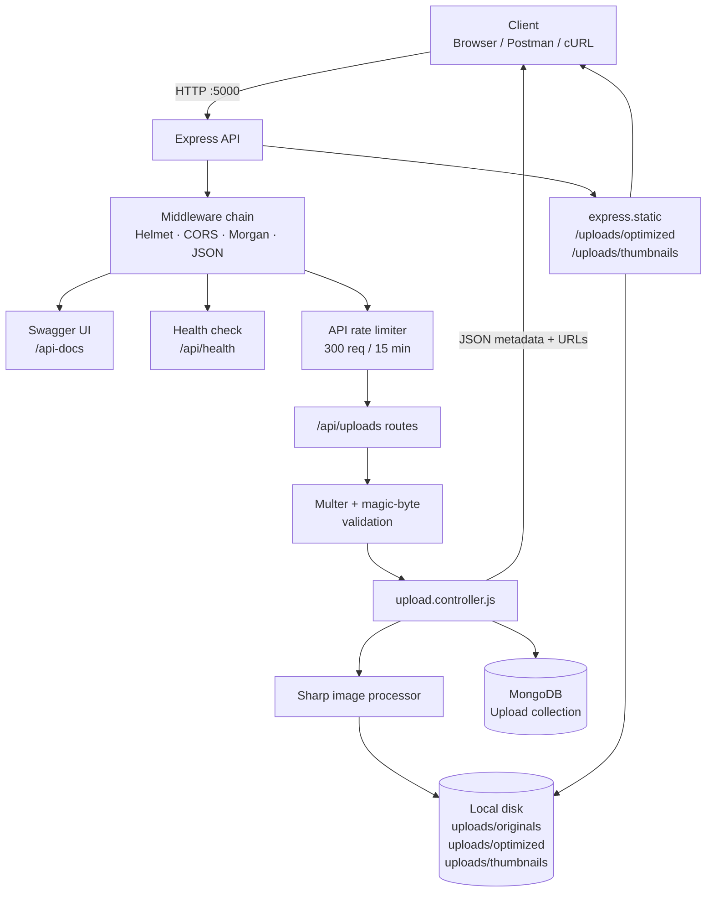
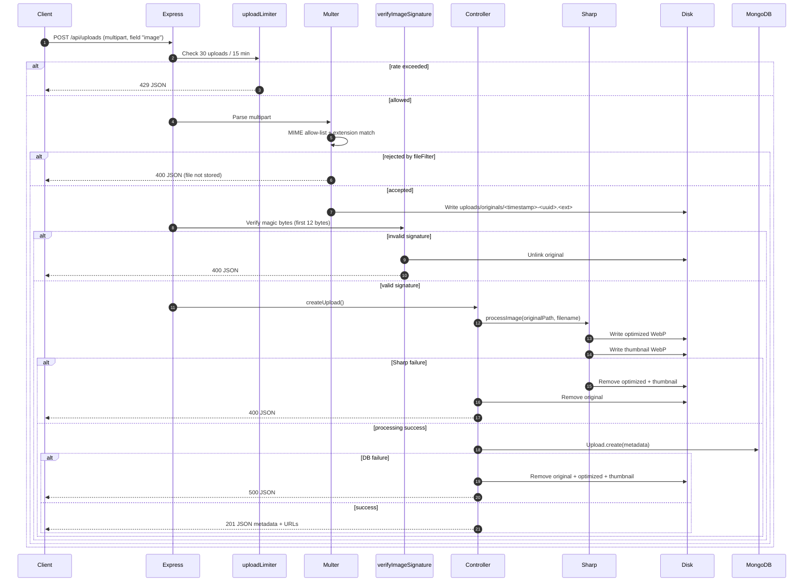

# Syntecxhub File Upload API

## Final Project Report

**Back-End Development Internship — Week 1, Project 3: File / Image Upload API**

| Document control | Detail |
|---|---|
| Project name | Syntecxhub File Upload API |
| Project type | REST API — file / image upload, processing, storage, and delivery |
| Internship program | Syntecxhub Back-End Development Internship |
| Assignment | Week 1 — Project 3: File / Image Upload API |
| Developer | Pawan Chaudhary (`pawan-chaudhary-70056`) |
| Contact | `ssmp70056@gmail.com` |
| Repository | `https://github.com/pawan-chaudhary-70056/Syntecxhub_File_Upload_API` |
| Branch | `main` |
| Project version | `1.0.0` |
| Report version | `1.0` (final) |
| Report date | 17 November 2026 |
| License | MIT |
| Status | Complete — 13/13 automated tests passing, live API verified |
| Verification environment | Ubuntu 26.04.1 LTS, Node.js v24.21.0, MongoDB 7.0.48 |

> This document is the complete technical and project report for the Syntecxhub File Upload API. It covers the assignment context, requirements, architecture, every source file, every endpoint, the database schema, the image-processing pipeline, security controls, error handling, testing, CI/CD, Docker deployment, setup, live verification evidence, limitations, and future work.

---

## Table of Contents

1. [Executive Summary](#1-executive-summary)
2. [Project Overview](#2-project-overview)
3. [Technology Stack](#3-technology-stack)
4. [System Architecture](#4-system-architecture)
5. [Configuration](#5-configuration)
6. [Database Design](#6-database-design)
7. [API Specification](#7-api-specification)
8. [Upload Pipeline — Deep Dive](#8-upload-pipeline--deep-dive)
9. [Image Processing](#9-image-processing)
10. [Security](#10-security)
11. [Error Handling](#11-error-handling)
12. [Testing and Quality Assurance](#12-testing-and-quality-assurance)
13. [CI/CD](#13-cicd)
14. [Docker and Deployment](#14-docker-and-deployment)
15. [Setup and Operation Guide](#15-setup-and-operation-guide)
16. [Code Quality and Design Decisions](#16-code-quality-and-design-decisions)
17. [Performance Observations](#17-performance-observations)
18. [Limitations and Future Work](#18-limitations-and-future-work)
19. [Conclusion](#19-conclusion)
- [Appendix A: Complete File Inventory](#appendix-a-complete-file-inventory)
- [Appendix B: Commit History](#appendix-b-commit-history)
- [Appendix C: Command Reference](#appendix-c-command-reference)
- [Appendix D: Verification Snapshot](#appendix-d-verification-snapshot)
- [Appendix E: Glossary](#appendix-e-glossary)
- [Appendix F: Submission Checklist](#appendix-f-submission-checklist)

---

## 1. Executive Summary

The **Syntecxhub File Upload API** is a production-minded REST API that accepts image uploads over `multipart/form-data`, verifies that the uploaded bytes are genuinely an allowed image, processes the image with Sharp, stores three files on disk (original, optimized image, and thumbnail), stores queryable metadata in MongoDB, and serves optimized WebP images and thumbnails over HTTP.

The API was built for **Week 1, Project 3** of the Syntecxhub Back-End Development Internship. The assignment asked for a file/image upload endpoint using **Multer**, metadata storage in **MongoDB**, a way to serve the uploaded image or return its URL, image-only validation, and a maximum file size. Every core requirement is implemented and verified. The implementation goes beyond the minimum by adding:

- Sharp-based optimization, resizing, WebP conversion, thumbnail generation, EXIF/GPS stripping, and decompression-bomb protection.
- Three independent file-validation layers: MIME allow-list, extension/MIME match, and magic-byte inspection.
- Safe static serving where originals remain private and only processed WebP files are public.
- Centralized error handling, consistent JSON response envelopes, and cleanup of orphan files on every failure path.
- Helmet security headers, CORS configuration, two-tier rate limiting, request logging, and graceful shutdown.
- OpenAPI 3.0.3 documentation served through Swagger UI.
- 13 automated integration tests using Node's built-in test runner and Supertest.
- GitHub Actions CI against a MongoDB 7 service container.
- A multi-stage Dockerfile and a Docker Compose stack with a persistent upload volume and an internal MongoDB service.
- A 14-request Postman collection with automated assertions and negative tests.

**Verification result:** all **13 automated tests pass** (0 failures, 610.67 ms total on the verification machine), and a live end-to-end run against MongoDB confirmed health checks, upload, retrieval, listing, static image serving, invalid-content rejection, and deletion. The live upload of an 800×600 JPEG (3,118 bytes) produced a 950-byte optimized WebP and a 160-byte thumbnail.

**Key engineering characteristics:** layered Express architecture, CommonJS modules, disk-backed uploads, MongoDB metadata, WebP delivery, strong input validation, defensive cleanup, non-root container execution, and no secrets committed to Git.

---

## 2. Project Overview

### 2.1 Background

File upload is a foundational backend capability used by profile pictures, product catalogs, chat attachments, documents, and content-management systems. A naive upload endpoint that simply writes whatever the client sends creates serious risks: malware disguised as images, path traversal, disk exhaustion, decompression bombs, privacy leaks through EXIF GPS data, and storage of unoptimized multi-megabyte files.

This project treats image upload as a complete pipeline rather than a single endpoint. The objective is to demonstrate that a small Express service can be **secure, observable, testable, documented, containerized, and maintainable** while remaining easy to run locally.

### 2.2 Problem Statement

Build a REST API that:

1. Accepts image uploads using Multer and `multipart/form-data`.
2. Stores file metadata (filename, path, URL, dimensions, sizes, MIME type) in MongoDB.
3. Serves the uploaded image or returns usable URLs.
4. Validates that only images are accepted.
5. Enforces a configurable maximum file size.
6. Handles failures gracefully without leaving orphan files.

### 2.3 Objectives

| # | Objective | Outcome |
|---|---|---|
| O1 | Accept single-image uploads | `POST /api/uploads` with `image` field |
| O2 | Validate image type and size | MIME + extension + magic-byte checks; 2 MB default limit |
| O3 | Process images efficiently | Sharp auto-rotate, resize, WebP conversion, thumbnail |
| O4 | Persist metadata | Mongoose `Upload` model in MongoDB |
| O5 | Serve processed images | Public optimized and thumbnail static routes |
| O6 | Support listing and retrieval | Pagination, MIME filtering, get-by-ID |
| O7 | Support deletion | Removes DB record and all three files |
| O8 | Protect the service | Helmet, CORS, rate limits, safe static serving, cleanup |
| O9 | Document the API | Swagger UI + OpenAPI 3.0.3 JSON |
| O10 | Prove correctness | 13 automated integration tests + Postman collection |
| O11 | Enable reproducible delivery | Dockerfile, Docker Compose, GitHub Actions CI |
| O12 | Keep originals private | Originals stored on disk but never exposed over HTTP |

### 2.4 Scope

**In scope**

- Single-image upload (JPEG, PNG, WebP, GIF).
- Image metadata extraction and persistence.
- Optimized WebP generation and square thumbnail generation.
- Listing with pagination and MIME-type filtering.
- Get-one and delete operations.
- Static delivery of processed images only.
- API documentation, automated tests, CI, Docker.
- Security hardening appropriate for a public demo API.

**Out of scope (by design)**

- User accounts, authentication, and authorization.
- Multi-file or chunked/resumable uploads.
- Cloud object storage (S3, GCS, Azure Blob) or CDN integration.
- Virus/malware scanning and content moderation.
- Video, audio, PDF, or document uploads.
- Image editing, cropping by client coordinates, filters, or AI processing.
- Billing, quotas per user, and multi-tenancy.
- Horizontal scaling and distributed rate limiting.

### 2.5 Requirement Traceability Matrix

| Assignment requirement | Implementation | Verification |
|---|---|---|
| Accept file/image uploads | `POST /api/uploads`, `multipart/form-data`, field `image` | Automated test #2; live upload returned `201` |
| Use Multer for multipart/form-data | `src/middleware/upload.middleware.js` — `multer.diskStorage`, `upload.single('image')` | Upload tests #2, #10 |
| Store metadata (filename, path, URL) in MongoDB | `src/models/Upload.js`; `Upload.create()` in controller | Test #2 queries MongoDB and checks all three paths exist |
| Serve images or return URLs | `express.static` for optimized/thumbnails; absolute + relative URLs in responses | Test #4 fetches both static URLs and checks `image/webp` |
| Validate file type (images only) | MIME allow-list + extension/MIME match + magic bytes | Tests #7, #8 |
| Set size limits | `MAX_FILE_SIZE` (2 MB default) enforced by Multer | Test #9 |
| **Extras** | Sharp pipeline, thumbnails, EXIF/GPS stripping, Swagger, tests, CI, Docker, rate limits, Helmet, graceful shutdown | Sections 9–14 |

### 2.6 Deliverables

| Deliverable | Location |
|---|---|
| Express application source | `src/` |
| Database model | `src/models/Upload.js` |
| OpenAPI specification | `src/docs/openapi.js` |
| Integration test suite | `tests/upload.test.js` |
| Postman collection | `postman/Syntecxhub_File_Upload_API.postman_collection.json` |
| CI workflow | `.github/workflows/ci.yml` |
| Container image definition | `Dockerfile` |
| Multi-service orchestration | `docker-compose.yml` |
| Environment template | `.env.example` |
| User documentation | `README.md`, `setup.md` |
| This report | `report/FINAL_REPORT.md` |

---

## 3. Technology Stack

### 3.1 Core Technologies

| Layer | Technology | Role in this project |
|---|---|---|
| Runtime | Node.js 18+ (verified on v24.21.0) | JavaScript server runtime |
| HTTP framework | Express 4.22.3 | Routing, middleware, static serving |
| Database | MongoDB 7.0.48 | Document store for upload metadata |
| ODM | Mongoose 8.24.9 | Schema, validation, indexes, queries |
| Upload parser | Multer 2.5.0 | `multipart/form-data` parsing and disk storage |
| Image processing | Sharp 0.35.5 | Decoding, rotation, resize, WebP encode, thumbnails |
| API docs | swagger-ui-express 5.0.1 + OpenAPI 3.0.3 | Interactive documentation |
| Security | Helmet 8.3.0, CORS 2.8.6, express-rate-limit 7.5.1 | Headers, origin control, throttling |
| Logging | Morgan 1.12.1 | HTTP request logs |
| Configuration | dotenv 16.6.1 | `.env` loading |
| Testing | Node test runner + Supertest 7.3.2 | Integration tests |
| Dev reload | Nodemon 3.1.14 | Auto-restart during development |
| CI | GitHub Actions | Automated tests on push/PR |
| Containers | Docker 29.8.0, Docker Compose v5.6.0 | Reproducible deployment |
| Version control | Git 2.53.0 | Source history |

### 3.2 Exact Dependency Versions (from `package-lock.json`)

**Production dependencies**

| Package | Declared range | Installed |
|---|---|---|
| `cors` | `^2.8.5` | 2.8.6 |
| `dotenv` | `^16.4.7` | 16.6.1 |
| `express` | `^4.21.2` | 4.22.3 |
| `express-rate-limit` | `^7.5.0` | 7.5.1 |
| `helmet` | `^8.0.0` | 8.3.0 |
| `mongoose` | `^8.9.5` | 8.24.9 |
| `morgan` | `^1.10.0` | 1.12.1 |
| `multer` | `^2.0.1` | 2.5.0 |
| `sharp` | `^0.35.5` | 0.35.5 |
| `swagger-ui-express` | `^5.0.1` | 5.0.1 |

**Development dependencies**

| Package | Declared range | Installed |
|---|---|---|
| `nodemon` | `^3.1.9` | 3.1.14 |
| `supertest` | `^7.3.2` | 7.3.2 |

**Package manager metadata**

- `package-lock.json` lockfile version: **3**
- Total resolved packages in the lockfile: **187**
- Node engine requirement: **`>= 18`**
- Module system: **CommonJS** (`require` / `module.exports`)

### 3.3 Why These Technologies

- **Express** is the most widely used Node HTTP framework, with a simple middleware model that maps cleanly to the request pipeline.
- **Multer** is the standard Express solution for `multipart/form-data` and supports disk storage with file-size and count limits.
- **Sharp** uses libvips, is significantly faster and lighter than ImageMagick-based alternatives, installs prebuilt binaries, and strips metadata by default.
- **MongoDB + Mongoose** fit document-shaped metadata with optional fields and provide schema validation and indexes without migrations.
- **WebP** provides strong compression and broad browser support while preserving transparency.
- **Node's built-in test runner** avoids adding Jest/Mocha and keeps the toolchain minimal; **Supertest** tests the real Express app in-process.
- **Docker Compose** makes the API and MongoDB reproducible with one command.
- **GitHub Actions** provides free CI with a MongoDB service container.

### 3.4 Verification Environment

| Item | Value |
|---|---|
| Operating system | Ubuntu 26.04.1 LTS |
| Kernel | Linux 7.0.0-43-generic x86_64 |
| Node.js | v24.21.0 |
| npm | 12.2.1 |
| MongoDB | v7.0.48 (local `mongod` service) |
| Docker | 29.8.0 |
| Docker Compose | v5.6.0 |
| Git | 2.53.0 |
| OpenSSL | 3.5.5 |

> The project declares Node.js `>= 18`, uses Node 20 in CI and Docker, and was verified locally on Node 24. No Node-24-only APIs are used.

---

## 4. System Architecture

### 4.1 High-Level Architecture



### 4.2 Layered Design

| Layer | Files | Responsibility |
|---|---|---|
| Entry point | `src/server.js` | Loads env, connects DB, starts HTTP server, graceful shutdown |
| Application | `src/app.js` | Builds Express app, mounts middleware/routes, health, docs, static files, error handlers |
| Configuration | `src/config/db.js`, `src/config/upload.js` | MongoDB connection and upload/image constants |
| Routing | `src/routes/upload.routes.js` | Maps HTTP verbs and paths to middleware + controller |
| Middleware | `src/middleware/*.js` | Upload parsing, signature verification, rate limiting, 404, errors |
| Controllers | `src/controllers/upload.controller.js` | Request handling, validation, orchestration, response shaping |
| Model | `src/models/Upload.js` | MongoDB schema, validation, indexes |
| Utilities | `src/utils/*.js` | Custom error, async wrapper, magic bytes, Sharp pipeline |
| Documentation | `src/docs/openapi.js` | OpenAPI 3.0.3 specification |
| Tests | `tests/upload.test.js` | End-to-end API integration tests |

The design deliberately keeps the layering thin: routes are declarative, middleware handles transport-level concerns, and the controller contains the small amount of business logic required. Sharp and file cleanup are isolated in utilities so the controller stays readable.

### 4.3 Directory Structure

```text
Syntecxhub_File_Upload_API/
├── .github/
│   └── workflows/
│       └── ci.yml                         # GitHub Actions CI
├── postman/
│   └── Syntecxhub_File_Upload_API.postman_collection.json
├── src/
│   ├── config/
│   │   ├── db.js                          # MongoDB connection
│   │   └── upload.js                      # Upload + image constants
│   ├── controllers/
│   │   └── upload.controller.js           # Create, list, get, delete
│   ├── docs/
│   │   └── openapi.js                     # OpenAPI 3.0.3 document
│   ├── middleware/
│   │   ├── error.middleware.js            # Central error handler
│   │   ├── notFound.middleware.js         # 404 catch-all
│   │   ├── rateLimit.middleware.js        # API + upload limiters
│   │   └── upload.middleware.js           # Multer + magic-byte verification
│   ├── models/
│   │   └── Upload.js                      # Mongoose schema
│   ├── routes/
│   │   └── upload.routes.js               # /api/uploads routes
│   ├── utils/
│   │   ├── ApiError.js                    # Operational HTTP error
│   │   ├── asyncHandler.js                # Promise-to-next wrapper
│   │   ├── fileSignature.js               # Magic-byte validators
│   │   └── imageProcessor.js              # Sharp pipeline + cleanup
│   ├── app.js                             # Express application
│   └── server.js                          # Process entry point
├── tests/
│   └── upload.test.js                     # 13 integration tests
├── uploads/
│   ├── .gitkeep
│   ├── originals/                         # Private originals (gitignored)
│   ├── optimized/                         # Public WebP (gitignored)
│   └── thumbnails/                        # Public WebP (gitignored)
├── .dockerignore
├── .env.example
├── .gitignore
├── Dockerfile
├── docker-compose.yml
├── package.json
├── package-lock.json
├── README.md
├── setup.md
└── report/
    └── FINAL_REPORT.md                    # This document
```

### 4.4 File Inventory and Line Counts

| File | Lines | Primary symbols | Responsibility |
|---|---:|---|---|
| `src/server.js` | 58 | `startServer`, `shutdown` | Load env, connect DB, listen, graceful exit |
| `src/app.js` | 138 | `app` | Compose Express app and middleware |
| `src/config/db.js` | 27 | `connectDB` | Validate URI, connect Mongoose, log host/DB |
| `src/config/upload.js` | 51 | `ALLOWED_IMAGE_TYPES`, `MAX_FILE_SIZE`, paths | Single source of upload configuration |
| `src/controllers/upload.controller.js` | 248 | `createUpload`, `listUploads`, `getUploadById`, `deleteUpload` | Request handling and response shaping |
| `src/docs/openapi.js` | 408 | `openapiSpec` | OpenAPI paths, schemas, examples |
| `src/middleware/upload.middleware.js` | 109 | `uploadSingleImage`, `verifyImageSignature` | Multer config, MIME/extension filter, magic bytes |
| `src/middleware/error.middleware.js` | 77 | `errorHandler` | Normalize Multer/Mongoose/Mongo errors |
| `src/middleware/notFound.middleware.js` | 10 | `notFound` | JSON 404 for unknown routes |
| `src/middleware/rateLimit.middleware.js` | 30 | `apiLimiter`, `uploadLimiter` | Request throttling |
| `src/models/Upload.js` | 95 | `Upload` model | Schema, validation, indexes |
| `src/routes/upload.routes.js` | 23 | `router` | Route declarations |
| `src/utils/ApiError.js` | 17 | `ApiError` | Status-coded operational error |
| `src/utils/asyncHandler.js` | 8 | `asyncHandler` | Forward async rejections |
| `src/utils/fileSignature.js` | 57 | `hasValidImageSignature` | JPEG/PNG/GIF/WebP magic bytes |
| `src/utils/imageProcessor.js` | 121 | `processImage`, `removeFiles` | Sharp processing and file cleanup |
| `tests/upload.test.js` | 237 | 13 `test()` cases | Integration testing |
| **Total JavaScript** | **1,714** | | 1,477 source + 237 test lines |

Additional non-code files: `package.json` (44 lines), `package-lock.json` (dependency lock), `README.md` (332 lines), `setup.md` (670 lines), `Dockerfile` (33 lines), `docker-compose.yml` (51 lines), `ci.yml` (42 lines), Postman collection, `.env.example`, `.gitignore`, `.dockerignore`. The repository has **29 tracked files**; the tracked project (excluding `node_modules/`, `.git/`, and the new `report/` directory) is approximately **496 KB**.

### 4.5 Middleware Execution Order

Order matters in Express. The application mounts components in this exact sequence (`src/app.js`):

| # | Middleware / route | Mount | Purpose |
|---:|---|---|---|
| 1 | `app.disable('x-powered-by')` | global | Hide framework identity |
| 2 | Helmet | global | Security headers; CORP set to `cross-origin` |
| 3 | CORS | global | Origin allow-list, methods, headers |
| 4 | Morgan | global (not in test) | `dev` or `combined` request logging |
| 5 | `express.json` / `express.urlencoded` | global | JSON/form bodies limited to 10 KB |
| 6 | `express.static` | `/uploads/optimized` | Public WebP images |
| 7 | `express.static` | `/uploads/thumbnails` | Public WebP thumbnails |
| 8 | Docs CSP + `swaggerUi` | `/api-docs` | Interactive documentation |
| 9 | `GET /api-docs.json` | exact | Raw OpenAPI JSON |
| 10 | `GET /api/health` | exact | Health and DB state |
| 11 | `GET /favicon.ico` | exact | Quiet `204` response |
| 12 | `apiLimiter` | `/api` | 300 requests / 15 minutes |
| 13 | Upload router | `/api/uploads` | Upload, list, get, delete |
| 14 | `notFound` | global | JSON `404` |
| 15 | `errorHandler` | global | Normalized error responses |

**Important consequences of this order**

- `/api/health` is registered **before** the API limiter, so monitoring is never rate-limited.
- Swagger UI and `/api-docs.json` are also outside the API limiter.
- Static files are mounted before the limiter and are not throttled.
- The 10 KB JSON limit does not affect multipart uploads because Multer processes those bodies separately.
- `notFound` and `errorHandler` are last, so every unmatched route and every thrown error reaches them.

### 4.6 Request Lifecycle (Generic)

1. Node receives the TCP request on port `5000`.
2. Helmet adds security headers.
3. CORS checks the request origin against `CORS_ORIGIN`.
4. Morgan records the request (except in tests).
5. Body parsers run for JSON/form bodies.
6. Static middleware attempts to serve processed files for `/uploads/optimized` and `/uploads/thumbnails`.
7. Swagger, health, or favicon routes may terminate the request.
8. `/api/*` requests pass through the API rate limiter.
9. `/api/uploads/*` requests reach the upload router.
10. The controller executes and either responds or throws.
11. Errors flow to the central error handler; unmatched routes flow to the 404 middleware first.
12. The response is serialized as JSON (or the static file is streamed).

### 4.7 Data Storage Layout

| Asset | Location | Public? | Contents |
|---|---|---|---|
| Original upload | `uploads/originals/<timestamp>-<uuid>.<ext>` | **No** | Exact bytes accepted from the client |
| Optimized image | `uploads/optimized/<timestamp>-<uuid>.webp` | Yes | Auto-rotated, resized, WebP-encoded image |
| Thumbnail | `uploads/thumbnails/<timestamp>-<uuid>.webp` | Yes | 200×200 cover-cropped WebP |
| Metadata | MongoDB `uploads` collection | API only | Paths, URLs, dimensions, sizes, MIME type, timestamps |

The original and processed files share the same base name (the `.webp` outputs replace the original extension). Example from the live verification run:

```text
uploads/originals/1794900559932-7e9d3c12-cc90-42a1-89a4-2dc7fce7e81f.jpg
uploads/optimized/1794900559932-7e9d3c12-cc90-42a1-89a4-2dc7fce7e81f.webp
uploads/thumbnails/1794900559932-7e9d3c12-cc90-42a1-89a4-2dc7fce7e81f.webp
```

### 4.8 Runtime and Deployment Topologies

**Local development**

```text
npm run dev (nodemon)  ──►  Express :5000  ──►  local MongoDB :27017
                                  │
                                  └──►  local uploads/ directory
```

**Docker Compose**

```text
Host :5000  ──►  api container (node:20-slim, non-root)
                     │
                     ├──►  uploads volume  (/app/uploads)
                     └──►  mongo container (mongo:7, internal network only)
                               │
                               └──►  mongo-data volume (/data/db)
```

**Production (recommended, not implemented as code)**

```text
Client ──► TLS terminator / reverse proxy ──► API replicas ──► MongoDB Atlas
                                                │
                                                └──► shared object storage or shared volume
```

> Because uploads are written to local disk, multiple API replicas require a shared volume or a migration to object storage. See Section 18.

---

## 5. Configuration

### 5.1 Environment Variables

All runtime configuration is supplied through environment variables. `dotenv` is loaded once at the top of `src/server.js` before any application module is required.

| Variable | Default | Actual local `.env` | Description |
|---|---|---:|---|
| `PORT` | `5000` | `5000` | HTTP port |
| `NODE_ENV` | `development` | `development` | `development`, `production`, or `test` |
| `MONGO_URI` | — (required) | `mongodb://127.0.0.1:27017/syntecxhub_file_upload_API` | MongoDB local or Atlas URI |
| `BASE_URL` | `http://localhost:5000` | `http://localhost:5000` | Base for absolute image URLs and OpenAPI server |
| `CORS_ORIGIN` | `*` | `*` | Comma-separated origin allow-list or `*` |
| `UPLOAD_DIR` | `uploads` | `uploads` | Upload root (resolved to an absolute path) |
| `MAX_FILE_SIZE` | `2097152` (2 MB) | `2097152` | Maximum upload size in bytes |
| `IMAGE_MAX_WIDTH` | `1920` | `1920` | Optimized image maximum width |
| `IMAGE_MAX_HEIGHT` | `1920` | `1920` | Optimized image maximum height |
| `THUMBNAIL_SIZE` | `200` | `200` | Thumbnail width and height in pixels |
| `WEBP_QUALITY` | `82` | `82` | Optimized WebP quality (1–100) |
| `MAX_IMAGE_PIXELS` | `268402689` | `268402689` | Decompression-bomb pixel limit (16,383 × 16,383) |

### 5.2 Configuration Module Behavior

`src/config/upload.js` resolves configuration once at module load:

- `UPLOAD_DIR` is resolved with `path.resolve()`, so relative values are anchored to the process working directory.
- `ORIGINALS_DIR`, `OPTIMIZED_DIR`, and `THUMBNAILS_DIR` are derived by joining `originals`, `optimized`, and `thumbnails` onto the root.
- Numeric settings use `Number(value) || default`, meaning an unset, empty, or `0` value falls back to the default.
- `ALLOWED_IMAGE_TYPES` is a `Map` from MIME type to allowed extensions:
  - `image/jpeg` → `.jpg`, `.jpeg`
  - `image/png` → `.png`
  - `image/webp` → `.webp`
  - `image/gif` → `.gif`
- `ALLOWED_MIME_TYPES` is the array of map keys, reused by the controller, model, and error messages.

`src/config/db.js` requires `MONGO_URI`, sets `strictQuery: true`, connects with a **10-second server-selection timeout**, and logs the connected host and database name. A missing URI throws a clear error before the server starts.

### 5.3 Secrets and Environment Hygiene

- `.env` is **gitignored** and is **not** among the 29 tracked files.
- `.env.example` is tracked and contains only safe defaults.
- `.dockerignore` excludes `.env` and `.env.*` from the image build context.
- No API keys, passwords, or tokens exist in the repository.
- The MongoDB URI in `.env.example` uses a local connection with no credentials.
- The actual local database name (`syntecxhub_file_upload_API`) differs from the example (`syntecxhub_upload`); this is harmless and reflects local setup.

---

## 6. Database Design

### 6.1 Collection

MongoDB database: configurable (local default `syntecxhub_upload`; test database `syntecxhub_upload_test`; the developer's local `.env` uses `syntecxhub_file_upload_API`).

Collection: **`uploads`** (Mongoose pluralizes the `Upload` model).

### 6.2 Schema Fields

`src/models/Upload.js` defines the following schema:

| Field | Type | Required | Constraints | Public in API? | Meaning |
|---|---|---:|---|---:|---|
| `_id` | ObjectId | auto | MongoDB primary key | Yes (as `id`) | Unique upload identifier |
| `originalName` | String | Yes | trim, max 255 | Yes | Sanitized client filename |
| `filename` | String | Yes | trim, **unique** | Yes | Stored original filename on disk |
| `path` | String | Yes | trim | **No** | Absolute path to original |
| `optimizedPath` | String | Yes | trim | **No** | Absolute path to optimized WebP |
| `thumbnailPath` | String | Yes | trim | **No** | Absolute path to thumbnail WebP |
| `url` | String | Yes | trim | Yes (absolute + relative) | Relative optimized URL |
| `thumbnailUrl` | String | Yes | trim | Yes (absolute + relative) | Relative thumbnail URL |
| `mimetype` | String | Yes | enum of four allowed MIME types | Yes | Original MIME type |
| `format` | String | Yes | trim | Yes | Original format reported by Sharp (e.g. `jpeg`) |
| `width` | Number | Yes | min 1 | Yes | Optimized image width |
| `height` | Number | Yes | min 1 | Yes | Optimized image height |
| `size` | Number | Yes | min 1 | Yes | Original byte size |
| `optimizedSize` | Number | Yes | min 1 | Yes | Optimized byte size |
| `thumbnailSize` | Number | Yes | min 1 | Yes | Thumbnail byte size |
| `createdAt` | Date | auto | timestamps | Yes | Creation time |
| `updatedAt` | Date | auto | timestamps | Yes | Last update time |

Schema options:

```js
{
  timestamps: true,   // createdAt + updatedAt
  versionKey: false   // no __v field
}
```

### 6.3 Indexes

| Index | Definition | Reason |
|---|---|---|
| `_id` | Default MongoDB index | Primary lookups and uniqueness |
| `filename` | Unique index (created by `unique: true`) | Prevents duplicate stored filenames |
| `createdAt` | `{ createdAt: -1 }` | Fast newest-first listing and sorting |

`strictQuery: true` is set globally, so filters with fields not in the schema are ignored rather than silently matching unexpected documents.

### 6.4 Example Document

```json
{
  "_id": "6afc024fb329e442e59788bc",
  "originalName": "sample.jpg",
  "filename": "1794900559932-7e9d3c12-cc90-42a1-89a4-2dc7fce7e81f.jpg",
  "path": "/home/bh_in_ew/.../uploads/originals/1794900559932-7e9d3c12-cc90-42a1-89a4-2dc7fce7e81f.jpg",
  "optimizedPath": "/home/bh_in_ew/.../uploads/optimized/1794900559932-7e9d3c12-cc90-42a1-89a4-2dc7fce7e81f.webp",
  "thumbnailPath": "/home/bh_in_ew/.../uploads/thumbnails/1794900559932-7e9d3c12-cc90-42a1-89a4-2dc7fce7e81f.webp",
  "url": "/uploads/optimized/1794900559932-7e9d3c12-cc90-42a1-89a4-2dc7fce7e81f.webp",
  "thumbnailUrl": "/uploads/thumbnails/1794900559932-7e9d3c12-cc90-42a1-89a4-2dc7fce7e81f.webp",
  "mimetype": "image/jpeg",
  "format": "jpeg",
  "width": 800,
  "height": 600,
  "size": 3118,
  "optimizedSize": 950,
  "thumbnailSize": 160,
  "createdAt": "2026-11-17T07:29:19.972Z",
  "updatedAt": "2026-11-17T07:29:19.972Z"
}
```

### 6.5 Record Lifecycle

| Stage | Action |
|---|---|
| Create | After Sharp succeeds, `Upload.create()` inserts the metadata document |
| Read | `findById`, `find`, and `countDocuments` power get/list |
| Update | **No update endpoint**; records are immutable in practice, so `updatedAt` remains equal to `createdAt` |
| Delete | Files are unlinked first (guarded), then `deleteOne()` removes the document |
| Test reset | `Upload.deleteMany({})` before each test; `dropDatabase()` after the suite |

### 6.6 Consistency Between Files and Metadata

MongoDB and the filesystem cannot participate in a single atomic transaction. The implementation minimizes inconsistency with explicit compensation:

- If image processing fails → original, optimized, and thumbnail files are removed.
- If metadata insertion fails → all three files are removed.
- If deletion fails because a path is outside `UPLOAD_DIR` → the operation aborts with `500` rather than deleting arbitrary files.
- If a file is already missing during deletion → `ENOENT` is ignored and the record is still removed.
- A hard process crash between file creation and database insertion can still leave orphan files; there is no startup reconciliation job. This is documented as a limitation.

---

## 7. API Specification

### 7.1 API Conventions

| Convention | Detail |
|---|---|
| Base URL | `http://localhost:5000` (configurable via `BASE_URL`) |
| Content type | JSON responses (`application/json`); uploads use `multipart/form-data` |
| Success envelope | `{ "success": true, "message": "...", "data": ... }` |
| Error envelope | `{ "success": false, "message": "...", "errors": ["..."]? }` |
| Field naming | `camelCase` |
| Identifiers | MongoDB ObjectId rendered as a 24-character hex string |
| Timestamps | ISO 8601 UTC strings |
| URLs | Absolute (`url`, `thumbnailUrl`) plus relative (`relativeUrl`, `relativeThumbnailUrl`) |
| Pagination | `page`, `limit`, `total`, `totalPages`, `hasNextPage`, `hasPrevPage` |
| Versioning | None (single `v1.0.0` deployment; no `/v1` prefix) |
| Authentication | None (public demo API; see limitations) |

### 7.2 Endpoint Summary

| # | Method | Path | Purpose | Success | Rate limited |
|---:|---|---|---|---:|---|
| 1 | `GET` | `/api/health` | Health and database status | `200` | No |
| 2 | `POST` | `/api/uploads` | Upload and process one image | `201` | 30 / 15 min |
| 3 | `GET` | `/api/uploads` | List uploads with pagination/filter | `200` | 300 / 15 min |
| 4 | `GET` | `/api/uploads/:id` | Get one upload's metadata | `200` | 300 / 15 min |
| 5 | `DELETE` | `/api/uploads/:id` | Delete metadata and all files | `200` | 300 / 15 min |
| 6 | `GET` | `/uploads/optimized/:filename` | Serve optimized WebP | `200` | No |
| 7 | `GET` | `/uploads/thumbnails/:filename` | Serve WebP thumbnail | `200` | No |
| 8 | `GET` | `/api-docs` | Swagger UI | `200` | No |
| 9 | `GET` | `/api-docs.json` | OpenAPI 3.0.3 JSON | `200` | No |
| 10 | `GET` | `/favicon.ico` | Quiet favicon handling | `204` | No |

All other routes return a JSON `404`.

---

### 7.3 `GET /api/health`

**Purpose:** Liveness/readiness signal for humans, Docker, uptime monitors, and CI.

**Request:** no parameters, no body, no authentication.

**Handler:** inline in `src/app.js:107-124`.

**Behavior:** reads `process.uptime()`, current time, and `mongoose.connection.readyState`, mapped through:

```js
['disconnected', 'connected', 'connecting', 'disconnecting']
```

Ready state `1` means **connected**. Any unexpected state becomes `"unknown"`.

**Response `200`:**

```json
{
  "success": true,
  "message": "API is healthy",
  "data": {
    "uptime": 2.949315774,
    "timestamp": "2026-11-17T07:29:19.914Z",
    "database": "connected"
  }
}
```

**Notes:**

- Mounted before the API rate limiter, so health checks are not throttled.
- It always returns HTTP `200`; the `database` field carries the dependency state. Consumers should inspect `data.database`, not only the status code.
- The Docker `HEALTHCHECK` uses this endpoint and treats only `response.ok` as healthy, so a `200` with `database: "disconnected"` would still be considered healthy by the container check. See Section 18.

---

### 7.4 `POST /api/uploads`

**Purpose:** Upload, validate, process, persist, and return metadata for one image.

**Request**

- `Content-Type: multipart/form-data`
- Exactly one file part named **`image`**
- Allowed MIME types: `image/jpeg`, `image/png`, `image/webp`, `image/gif`
- Extension must match the MIME type (`.jpg`/`.jpeg`, `.png`, `.webp`, `.gif`)
- Maximum file size: `MAX_FILE_SIZE` = 2,097,152 bytes (2 MB) by default
- Multipart limits: 1 file, 5 fields, 10 parts

```bash
curl -X POST http://localhost:5000/api/uploads \
  -F "image=@/path/to/photo.jpg"
```

**Middleware chain**

```text
uploadLimiter → uploadSingleImage (Multer) → verifyImageSignature → createUpload
```

**Response `201 Created`:**

```json
{
  "success": true,
  "message": "Image uploaded and processed successfully",
  "data": {
    "id": "6afc024fb329e442e59788bc",
    "originalName": "sample.jpg",
    "filename": "1794900559932-7e9d3c12-cc90-42a1-89a4-2dc7fce7e81f.jpg",
    "url": "http://localhost:5055/uploads/optimized/1794900559932-7e9d3c12-cc90-42a1-89a4-2dc7fce7e81f.webp",
    "thumbnailUrl": "http://localhost:5055/uploads/thumbnails/1794900559932-7e9d3c12-cc90-42a1-89a4-2dc7fce7e81f.webp",
    "relativeUrl": "/uploads/optimized/1794900559932-7e9d3c12-cc90-42a1-89a4-2dc7fce7e81f.webp",
    "relativeThumbnailUrl": "/uploads/thumbnails/1794900559932-7e9d3c12-cc90-42a1-89a4-2dc7fce7e81f.webp",
    "mimetype": "image/jpeg",
    "format": "jpeg",
    "width": 800,
    "height": 600,
    "size": 3118,
    "optimizedSize": 950,
    "thumbnailSize": 160,
    "createdAt": "2026-11-17T07:29:19.972Z",
    "updatedAt": "2026-11-17T07:29:19.972Z"
  }
}
```

**Response field semantics**

| Field | Meaning |
|---|---|
| `id` | MongoDB document ID |
| `originalName` | Sanitized name supplied by the client |
| `filename` | Stored original filename (`timestamp-uuid.ext`) |
| `url` | Absolute URL of optimized WebP |
| `thumbnailUrl` | Absolute URL of thumbnail WebP |
| `relativeUrl` | Host-independent optimized path |
| `relativeThumbnailUrl` | Host-independent thumbnail path |
| `mimetype` | Original MIME type |
| `format` | Original format detected by Sharp |
| `width`, `height` | Dimensions of the **optimized** image |
| `size` | Original uploaded bytes |
| `optimizedSize` | Optimized WebP bytes |
| `thumbnailSize` | Thumbnail WebP bytes |
| `createdAt`, `updatedAt` | Mongoose timestamps |

**Internal fields intentionally not returned:** `path`, `optimizedPath`, `thumbnailPath`, `__v`. The automated test explicitly asserts that `path` is absent from the response.

**Success path:**

1. Multer writes `<timestamp>-<uuid>.<ext>` under `uploads/originals/`.
2. MIME and extension are checked before the file is accepted.
3. Magic bytes are read from the first 12 bytes; invalid content is deleted and rejected.
4. Sharp reads metadata, auto-rotates, resizes, and writes optimized + thumbnail WebP files.
5. The controller builds metadata and inserts a MongoDB document.
6. The API returns `201` with public metadata.

**Failure path (summary):** every failure removes partial artifacts; see Section 8.9 and Section 11.

**Possible errors:** `400` (missing file, wrong field, unsupported type, extension mismatch, bad signature, too large, unreadable/corrupt image, multipart limits), `429` (upload rate limit), `500` (unexpected server/DB error).

---

### 7.5 `GET /api/uploads`

**Purpose:** Paginated listing of upload metadata, newest first.

**Query parameters**

| Parameter | Type | Default | Rules | Description |
|---|---|---|---|---|
| `page` | integer | `1` | min 1 | Page number |
| `limit` | integer | `10` | 1–50 | Items per page |
| `mimetype` | string | — | one of four allowed MIME types | Filter by original type |

**Parsing behavior**

- `page`: `parseInt`; invalid or missing → `1`; values below `1` → `1`.
- `limit`: `parseInt`; invalid or missing → `10`; below `1` → `1`; above `50` → `50`.
- `mimetype`: if present and not in the allow-list → `400` with the allowed values.
- Results are sorted by `createdAt` descending.
- `countDocuments(filter)` and `find(...).skip().limit().lean()` run in parallel with `Promise.all`.

**Example**

```bash
curl "http://localhost:5000/api/uploads?page=1&limit=10&mimetype=image/png"
```

**Response `200`:**

```json
{
  "success": true,
  "message": "Uploads fetched successfully",
  "data": [
    {
      "id": "6afc024fb329e442e59788bc",
      "originalName": "sample.jpg",
      "filename": "1794900559932-7e9d3c12-cc90-42a1-89a4-2dc7fce7e81f.jpg",
      "url": "http://localhost:5055/uploads/optimized/1794900559932-7e9d3c12-cc90-42a1-89a4-2dc7fce7e81f.webp",
      "thumbnailUrl": "http://localhost:5055/uploads/thumbnails/1794900559932-7e9d3c12-cc90-42a1-89a4-2dc7fce7e81f.webp",
      "relativeUrl": "/uploads/optimized/1794900559932-7e9d3c12-cc90-42a1-89a4-2dc7fce7e81f.webp",
      "relativeThumbnailUrl": "/uploads/thumbnails/1794900559932-7e9d3c12-cc90-42a1-89a4-2dc7fce7e81f.webp",
      "mimetype": "image/jpeg",
      "format": "jpeg",
      "width": 800,
      "height": 600,
      "size": 3118,
      "optimizedSize": 950,
      "thumbnailSize": 160,
      "createdAt": "2026-11-17T07:29:19.972Z",
      "updatedAt": "2026-11-17T07:29:19.972Z"
    }
  ],
  "pagination": {
    "total": 1,
    "page": 1,
    "limit": 2,
    "totalPages": 1,
    "hasNextPage": false,
    "hasPrevPage": false
  }
}
```

**Pagination semantics**

| Field | Formula / meaning |
|---|---|
| `total` | Number of matching documents |
| `page` | Current page (1-based) |
| `limit` | Effective page size (clamped) |
| `totalPages` | `Math.ceil(total / limit)`; `0` when there are no records |
| `hasNextPage` | `page < totalPages` |
| `hasPrevPage` | `page > 1` |

**Empty result:** `data: []`, `total: 0`, `totalPages: 0`, both booleans `false`.

---

### 7.6 `GET /api/uploads/:id`

**Purpose:** Retrieve metadata for a single upload.

**Path parameter:** `id` — 24-character MongoDB ObjectId.

**Behavior**

1. `mongoose.isValidObjectId(id)` — invalid → `400 Invalid upload id: <id>`.
2. `Upload.findById(id).lean()` — missing → `404 Upload with id <id> not found`.
3. Valid → `200` with the same public upload shape used by the list endpoint.

**Response `200`:**

```json
{
  "success": true,
  "message": "Upload fetched successfully",
  "data": { "...": "same Upload object as Section 7.4" }
}
```

**Example**

```bash
curl http://localhost:5000/api/uploads/6afc024fb329e442e59788bc
```

---

### 7.7 `DELETE /api/uploads/:id`

**Purpose:** Permanently delete the database record and all three files.

**Path parameter:** `id` — 24-character ObjectId.

**Behavior**

1. Validate ObjectId → `400` if invalid.
2. Find the record → `404` if missing.
3. `removeFilesFromDisk([path, optimizedPath, thumbnailPath])`:
   - Resolves each path.
   - Refuses to delete anything that does not start with `<UPLOAD_DIR>/` (path-traversal guard).
   - Ignores `ENOENT` (already-missing file).
4. `upload.deleteOne()`.
5. Respond `200`.

**Response `200`:**

```json
{
  "success": true,
  "message": "Upload deleted successfully",
  "data": {
    "id": "6afc024fb329e442e59788bc"
  }
}
```

**Notes**

- Files are deleted **before** the database record. If a path guard fails, the request returns `500` and the record remains, which prevents silent database/file divergence for tampered records.
- After deletion, `GET /api/uploads/:id` returns `404`, and the public image URLs no longer resolve.
- Clients/CDNs may still have cached copies for up to the static `max-age` (1 day).

---

### 7.8 `GET /uploads/optimized/:filename`

**Purpose:** Serve the optimized WebP image.

**Implementation:** `express.static(OPTIMIZED_DIR, staticOptions)` in `src/app.js:66-69`.

**Static options**

| Option | Value | Effect |
|---|---|---|
| `dotfiles` | `'deny'` | Hidden files are not served |
| `index` | `false` | No directory index |
| `maxAge` | `'1d'` | `Cache-Control: public, max-age=86400` |
| `X-Content-Type-Options` | `nosniff` | Prevents MIME sniffing |
| `Content-Security-Policy` | `default-src 'none'; img-src 'self'` | Restricts the response context |
| `Cross-Origin-Resource-Policy` | `cross-origin` | Allows embedding by an allowed frontend |

**Response `200`:** `image/webp` with the file bytes.

**Response `404`:** Express static reports not found; the global 404 handler returns JSON.

**Security:** only files in `uploads/optimized/` are reachable. `..` traversal is normalized/rejected by `express.static`. Originals are **not** mounted at all.

---

### 7.9 `GET /uploads/thumbnails/:filename`

Identical behavior to Section 7.8, but serves `uploads/thumbnails/`. Thumbnails are 200×200 WebP (or the configured `THUMBNAIL_SIZE`), cover-cropped from the center, encoded at quality 75.

---

### 7.10 Interactive and Machine-Readable Documentation

| Route | Purpose | Implementation |
|---|---|---|
| `GET /api-docs` | Swagger UI | `swagger-ui-express` with custom title and options |
| `GET /api-docs.json` | Raw OpenAPI 3.0.3 document | Inline route returning `openapiSpec` |

The docs route sets its own Content-Security-Policy because Swagger UI requires inline scripts and styles:

```text
default-src 'self';
img-src 'self' data:;
style-src 'self' 'unsafe-inline';
script-src 'self' 'unsafe-inline';
font-src 'self' data:;
connect-src 'self';
worker-src 'self' blob:
```

Swagger options: `validatorUrl: null` (no external validator calls), `persistAuthorization: true`, custom site title.

**OpenAPI document contents**

- `openapi: 3.0.3`
- Title: “Syntecxhub File / Image Upload API”, version `1.0.0`
- Server URL from `BASE_URL`
- Tags: `Health`, `Uploads`, `Files`
- Paths: `/api/health`, `/api/uploads`, `/api/uploads/{id}`, `/uploads/optimized/{filename}`, `/uploads/thumbnails/{filename}`
- Schemas: `Upload`, `UploadResponse`, `UploadListResponse`, `Pagination`, `DeleteResponse`, `HealthResponse`, `ErrorResponse`
- Documented responses: `200`, `201`, `400`, `404`, `429`, `500` as applicable

The docs are available without authentication and are not rate-limited. For a hardened production deployment, restrict or disable them.

---

### 7.11 HTTP Status Code Matrix

| Status | Situations | Example message |
|---:|---|---|
| `200` | Health, list, get, delete, Swagger, static file | `Uploads fetched successfully` |
| `201` | Successful upload | `Image uploaded and processed successfully` |
| `204` | Favicon request | *(no body)* |
| `400` | Invalid ID, invalid MIME filter, missing file, wrong field, unsupported type, extension mismatch, bad magic bytes, oversized file, corrupt image, multipart limits, Mongoose validation, cast errors | `File is too large. Maximum allowed size is 2 MB.` |
| `404` | Unknown route, missing upload, missing static file | `Upload with id … not found` |
| `409` | Duplicate key (unique filename) | `A record with these values already exists.` |
| `429` | Rate limit exceeded | `Too many uploads from this IP. Please try again after 15 minutes.` |
| `500` | Unexpected error, DB failure, path guard violation | `Internal server error` / `Refusing to delete a file outside the upload directory.` |

**Success responses** always have `success: true`, a human-readable `message`, and a `data` payload (except `204`). **Error responses** always have `success: false` and a `message`; validation errors may add an `errors` string array.

---

### 7.12 Equivalent `curl` Examples

```bash
# Health
curl http://localhost:5000/api/health

# Upload (field must be "image")
curl -X POST http://localhost:5000/api/uploads \
  -F "image=@/path/to/photo.jpg"

# List with pagination and filter
curl "http://localhost:5000/api/uploads?page=1&limit=10&mimetype=image/png"

# Get one
curl http://localhost:5000/api/uploads/<id>

# Download optimized image
curl -o optimized.webp \
  http://localhost:5000/uploads/optimized/<filename>.webp

# Download thumbnail
curl -o thumbnail.webp \
  http://localhost:5000/uploads/thumbnails/<filename>.webp

# Delete
curl -X DELETE http://localhost:5000/api/uploads/<id>

# OpenAPI JSON
curl http://localhost:5000/api-docs.json
```

---

## 8. Upload Pipeline — Deep Dive

### 8.1 End-to-End Sequence



### 8.2 Step 1 — Rate Limiting

`uploadLimiter` runs before multipart parsing, which is important because parsing large bodies is expensive.

- Window: 15 minutes
- Limit: 30 uploads per IP per window
- Standard `RateLimit-*` headers (`draft-7`)
- Custom JSON body on `429`

The general API limiter allows 300 requests per 15 minutes, but the upload route combines both: a request counts toward `/api` and toward the stricter upload limiter.

### 8.3 Step 2 — Multer Parsing and First-Line Validation

`src/middleware/upload.middleware.js`:

- Ensures `uploads/originals`, `uploads/optimized`, and `uploads/thumbnails` exist at module load (`fs.mkdirSync(..., { recursive: true })`).
- Uses `multer.diskStorage` so file bytes stream to disk instead of being buffered in memory.
- Generates a filename as:

```text
`${Date.now()}-${crypto.randomUUID()}${extension}`
```

- Extension is lowercased and taken from the client filename.
- `fileFilter` performs two checks:
  1. MIME type exists in `ALLOWED_IMAGE_TYPES`.
  2. The extension is one of the allowed extensions for that MIME type.

Rejections return `ApiError(400)` through Multer. If `fileFilter` rejects, the file is not written.

**Multer limits**

| Limit | Value | Purpose |
|---|---:|---|
| `fileSize` | 2,097,152 bytes | Bound per-file size |
| `files` | 1 | Only one file part |
| `fields` | 5 | Bound non-file fields |
| `parts` | 10 | Bound total multipart parts |

### 8.4 Step 3 — Magic-Byte Verification

`src/utils/fileSignature.js` opens the file, reads at most 12 bytes, and compares against real file signatures:

| MIME | Signature |
|---|---|
| `image/jpeg` | First 3 bytes `FF D8 FF` |
| `image/png` | 8-byte PNG signature `89 50 4E 47 0D 0A 1A 0A` |
| `image/gif` | ASCII `GIF87a` or `GIF89a` |
| `image/webp` | ASCII `RIFF` at 0–3 and `WEBP` at 8–11 |

If the check fails, the middleware unlinks the file and returns:

```json
{
  "success": false,
  "message": "The uploaded file content does not match a supported image format."
}
```

If reading throws, the file is also removed and the error is forwarded. This is the defense that stops a text file renamed to `.png` with a spoofed `Content-Type`.

### 8.5 Step 4 — Filename Sanitization

The client-supplied `originalName` is sanitized before storage in MongoDB (`sanitizeOriginalName`):

1. Convert backslashes to forward slashes.
2. Take only the basename (strip directory components).
3. Replace any character outside `[A-Za-z0-9_.- ]` with `_`.
4. Truncate to 255 characters.
5. Fall back to `"unnamed"` if empty.

This value is metadata only; it is never used as a disk path, so path traversal through names is impossible.

### 8.6 Step 5 — Sharp Processing

`processImage(originalPath, storedFilename)`:

1. Reads metadata with `limitInputPixels` and `failOn: 'error'`.
2. Rejects unreadable images when width or height is missing.
3. Produces the optimized image:
   - `.rotate()` applies EXIF orientation.
   - `.resize({ width: 1920, height: 1920, fit: 'inside', withoutEnlargement: true })`.
   - `.webp({ quality: 82, effort: 4 })`.
4. Produces the thumbnail:
   - `.rotate()`.
   - `.resize({ width: 200, height: 200, fit: 'cover', position: 'centre' })`.
   - `.webp({ quality: 75, effort: 4 })`.
5. Reads optimized metadata and stats for both outputs.
6. Returns paths, public relative URLs, optimized dimensions, original format, and byte sizes.

Sharp does not copy EXIF/metadata unless `withMetadata()` is called, so EXIF, GPS, camera, and software metadata are stripped from both outputs by default. Orientation is applied first, so the visible image is correctly rotated before metadata is removed.

### 8.7 Step 6 — Metadata Persistence

The controller builds a document with:

- Sanitized original name
- Stored filename
- Absolute paths for original, optimized, and thumbnail
- Relative public URLs
- Original MIME type and format
- Optimized width/height
- Original, optimized, and thumbnail sizes

Mongoose validates required fields, the MIME enum, and minimum dimensions/sizes; the unique index on `filename` enforces filename uniqueness at the database level. A successful insert returns the document, which is immediately shaped into the public response.

### 8.8 Step 7 — Response Construction

`toPublicUpload(upload, req)`:

- Computes the base URL from `BASE_URL` (trailing slashes removed) or falls back to `req.protocol` + `req.get('host')`.
- Returns absolute URLs by prefixing the stored relative URLs.
- Returns both absolute and relative URLs for host portability.
- Omits internal filesystem paths.
- Converts `_id` to `id`.

### 8.9 Cleanup and Failure Matrix

| Failure point | Original file | Optimized file | Thumbnail | DB record | Client response |
|---|---|---|---|---|---|
| `fileFilter` rejects MIME/extension | Not written | — | — | — | `400` |
| Multer size/field/part limit | Partial file removed by Multer | — | — | — | `400` |
| Magic bytes invalid | Deleted by middleware | — | — | — | `400` |
| Sharp metadata/processing failure | Deleted by controller | Deleted by processor | Deleted by processor | — | `400` |
| MongoDB insert failure | Deleted by controller | Deleted | Deleted | Not created | `500` |
| Path guard fails during delete | Earlier files may be deleted | Earlier files may be deleted | Earlier files may be deleted | Record remains | `500` |
| Process crash mid-pipeline | Possible orphan | Possible orphan | Possible orphan | Possible missing record | Connection drops |
| Successful delete | Deleted | Deleted | Deleted | Deleted | `200` |

Cleanup helpers intentionally swallow errors during compensation (`catch(() => {})`) so the original failure is not masked. `removeFiles()` ignores `ENOENT`, making it safe to call twice.

### 8.10 Filename and Collision Properties

- The stored name combines a millisecond timestamp and a UUID v4.
- Collision probability is negligible; the unique index on `filename` is a second safeguard.
- Names are unguessable, which reduces enumeration risk for public files.
- The client's extension is preserved for the original, while both derivatives always use `.webp`.
- Original filenames are not used on disk, preventing overwrite attacks and unsafe characters.

---

## 9. Image Processing

### 9.1 Processing Operations

| Operation | Setting | Rationale |
|---|---|---|
| Decode limit | `limitInputPixels: 268,402,689` | Reject decompression bombs |
| Error policy | `failOn: 'error'` | Fail on corrupt input rather than silently proceeding |
| Orientation | `.rotate()` with no angle | Apply EXIF orientation before stripping |
| Optimized resize | Fit inside 1920×1920, no enlargement | Bound dimensions while preserving aspect ratio |
| Optimized format | WebP, quality 82, effort 4 | Strong compression with good visual quality |
| Thumbnail resize | 200×200, fit cover, center | Uniform square previews |
| Thumbnail format | WebP, quality 75, effort 4 | Small payload |
| Metadata | Not copied | Strip EXIF, GPS, and camera data |
| Animated GIF | First frame only | Output is a static WebP |

### 9.2 Output Naming

Given an original stored name `1794900559932-7e9d3c12-....jpg`:

```text
baseName              = 1794900559932-7e9d3c12-...
optimizedFilename     = <baseName>.webp
thumbnailFilename     = <baseName>.webp
```

The same base name is used in different directories, so images and thumbnails remain correlated without exposing the original extension.

### 9.3 Decompression-Bomb Protection

A small compressed file can decode to an enormous bitmap. Sharp's `limitInputPixels` prevents this by refusing images above the pixel budget. The default `268,402,689` pixels equals **16,383 × 16,383**, a libvips-aligned maximum that allows very large legitimate photos while stopping extreme bombs.

> At 4 bytes per pixel, the theoretical fully decoded size is about **1.07 GB**. Sharp/libvips streams processing rather than materializing the full RGBA buffer, but operators with limited memory should lower `MAX_IMAGE_PIXELS` (for example, 40–80 megapixels for typical web uploads).

### 9.4 Metadata and Privacy

Sharp strips metadata by default. This means:

- GPS coordinates are not published.
- Camera make/model, serial numbers, and timestamps are not published.
- Software and editing history are not published.
- Orientation is already applied, so stripping does not rotate the visible image.

### 9.5 Format Handling

| Input | `metadata.format` | Output | Notes |
|---|---|---|---|
| JPEG | `jpeg` | WebP | Transparency not applicable |
| PNG | `png` | WebP | Alpha preserved by WebP |
| WebP | `webp` | WebP | Re-encoded at configured quality |
| GIF | `gif` | WebP | First frame becomes static image |

### 9.6 Error Behavior

- If metadata cannot be read or width/height are absent → `ApiError(400, 'The uploaded file is not a readable image.')`.
- Any other Sharp error → logs the cause (outside tests) and throws `ApiError(400, 'Could not process the image. The file may be corrupted or too large.')`.
- In both cases, optimized and thumbnail files are removed, and the controller removes the original.

---

## 10. Security

### 10.1 Defense-in-Depth Summary

| # | Control | Implementation | What it prevents |
|---:|---|---|---|
| 1 | MIME allow-list | `config/upload.js` + Multer `fileFilter` | Non-image uploads (PDF, EXE, HTML, etc.) |
| 2 | Extension/MIME match | Multer `fileFilter` | Renamed files with inconsistent metadata |
| 3 | Magic-byte validation | `utils/fileSignature.js` | Spoofed `Content-Type` and fake images |
| 4 | File size limit | Multer `limits.fileSize` | Disk exhaustion and oversized uploads |
| 5 | Single-file limit | Multer `limits.files: 1` | Multi-file abuse in one request |
| 6 | Field/part limits | Multer `fields: 5`, `parts: 10` | Multipart resource abuse |
| 7 | Pixel limit | Sharp `limitInputPixels` | Decompression bombs |
| 8 | EXIF/GPS stripping | Sharp default metadata handling | Privacy leaks |
| 9 | Unguessable filenames | Timestamp + UUID v4 | Enumeration and collisions |
| 10 | Private originals | Only optimized/thumbnails are mounted | Exposure of raw uploads |
| 11 | Path-traversal guard | Prefix check against `UPLOAD_DIR` before delete | Arbitrary file deletion from tampered records |
| 12 | Safe static serving | `dotfiles: 'deny'`, `index: false`, `nosniff`, CSP | Hidden-file access, directory listing, MIME sniffing |
| 13 | Security headers | Helmet | Clickjacking, MIME sniffing, referrer leaks, etc. |
| 14 | CORS allow-list | `CORS_ORIGIN` parsing | Unauthorized browser origins |
| 15 | General rate limit | 300 requests / 15 min per IP | Scraping and request floods |
| 16 | Upload rate limit | 30 uploads / 15 min per IP | Expensive upload abuse |
| 17 | Small JSON body limit | 10 KB for JSON/urlencoded | JSON body floods |
| 18 | No stack traces returned | Error middleware | Internal path/stack disclosure |
| 19 | Filename sanitization | `sanitizeOriginalName` | Stored XSS/injection payloads in metadata |
| 20 | Orphan cleanup | Compensation in controller/processor/middleware | Disk bloat from failed requests |
| 21 | Graceful shutdown | `server.close` + Mongoose close + timeout | Dropped connections and unclean exits |
| 22 | Framework header hidden | `x-powered-by` disabled | Version fingerprinting |
| 23 | Secrets excluded | `.gitignore` + `.dockerignore` + `.env.example` | Credential leaks |
| 24 | Non-root container | `USER node` | Container privilege escalation impact |
| 25 | Internal MongoDB in Compose | No published `27017` port | Direct database exposure |
| 26 | Container health check | `HEALTHCHECK` + Compose healthcheck | Routing traffic to unhealthy services |

### 10.2 Threat Model

| Threat | Example | Mitigation | Residual risk |
|---|---|---|---|
| Malware upload | `.exe` renamed to `.png` | MIME/extension/magic bytes | Polyglot or steganographic payloads are not scanned |
| Decompression bomb | Tiny file decoding to gigapixels | `MAX_IMAGE_PIXELS` | Limit is large by default (~1.07 GB theoretical) |
| Upload flood | Thousands of requests | Rate limits and size caps | In-memory limiter resets on restart; no distributed store |
| Path traversal (download) | `GET /uploads/optimized/../../etc/passwd` | `express.static` normalization | None known for mounted roots |
| Path traversal (delete) | Tampered DB path `/etc/passwd` | `UPLOAD_DIR` prefix guard | Partial deletion possible before guard throws (see 18) |
| Stored XSS via filename | `<script>alert(1)</script>.png` | Sanitization + JSON encoding | Depends on client rendering; API returns plain JSON |
| Privacy leak | EXIF GPS coordinates | Sharp strips metadata | Original file retains EXIF on disk (private) |
| Information disclosure | Stack traces with absolute paths | Error handler never returns stacks | Server logs still contain stacks |
| Unauthorized access | Anyone can list/delete | None — public demo API | **Major:** add authentication before production |
| Database exposure | Direct MongoDB access | Docker internal network; Atlas IP allow-list | Local dev exposes 27017 by default |
| Credential leak | `.env` committed | Gitignore/dockerignore | Developer must still avoid force-adds |
| Container escape | Compromised process | Non-root user, slim image | Base-image vulnerabilities remain |

### 10.3 Security Headers

Helmet is applied globally with `crossOriginResourcePolicy: { policy: 'cross-origin' }`. A live `HEAD` request to an optimized image returned:

```text
Content-Security-Policy: default-src 'none'; img-src 'self'
Cross-Origin-Opener-Policy: same-origin
Cross-Origin-Resource-Policy: cross-origin
Origin-Agent-Cluster: ?1
Referrer-Policy: no-referrer
Strict-Transport-Security: max-age=31536000; includeSubDomains
X-Content-Type-Options: nosniff
X-DNS-Prefetch-Control: off
X-Download-Options: noopen
X-Frame-Options: SAMEORIGIN
X-Permitted-Cross-Domain-Policies: none
```

> HSTS is sent even over local HTTP; browsers ignore it on HTTP, and it becomes effective when the API is served over HTTPS. The docs route replaces the CSP with a Swagger-compatible policy.

### 10.4 Rate Limiting

| Limiter | Scope | Window | Limit | Applied to |
|---|---|---:|---:|---|
| `apiLimiter` | All `/api/*` routes mounted after it | 15 min | 300 | List, get, delete, upload (also upload limiter) |
| `uploadLimiter` | Upload route | 15 min | 30 | `POST /api/uploads` |

- Uses `standardHeaders: 'draft-7'` and disables legacy `X-RateLimit-*` headers.
- Exceeded limits return a JSON body with `success: false` and a clear message.
- Health, Swagger, and static files are exempt by mount order.
- The store is the default in-memory store, so counters are per process and reset on restart. Behind a reverse proxy, Express `trust proxy` must be configured or all clients may share the proxy's IP.

### 10.5 CORS

`CORS_ORIGIN` is split on commas, trimmed, and filtered. If it contains `*`, the origin is `*`; otherwise the array is passed to the `cors` package.

- Methods: `GET`, `POST`, `DELETE`, `OPTIONS`
- Allowed request headers: `Content-Type`
- Preflight cache: 86,400 seconds
- Default local value: `*` (development convenience)
- Production recommendation: set an explicit frontend origin and add `Authorization` to allowed headers if authentication is introduced

### 10.6 Path-Traversal Protection on Delete

The delete path derives from database records, which could theoretically be tampered with (for example, through direct DB access). `removeFilesFromDisk` resolves each path and requires:

```js
resolvedPath.startsWith(`${UPLOAD_DIR}${path.sep}`)
```

If not, it throws `ApiError(500, 'Refusing to delete a file outside the upload directory.')` and stops. This prevents a malicious or corrupted record from deleting arbitrary server files.

**Caveat:** files are processed sequentially. If a valid file is deleted before an invalid path is encountered, the operation is partially applied; the database record is not removed because the throw happens before `deleteOne()`. This is an extremely rare tampering scenario and is documented in Section 18.

### 10.7 Privacy of Originals

- Originals live in `uploads/originals/`.
- Only `uploads/optimized/` and `uploads/thumbnails/` are mounted with `express.static`.
- A request to `/uploads/originals/<filename>` has no matching route and returns JSON `404`.
- The automated test **“original files are not publicly served”** verifies this.
- Original EXIF data remains on the private original; public derivatives are stripped.

### 10.8 Container and Secret Hygiene

- Docker image runs as the unprivileged `node` user.
- `.dockerignore` excludes `.env`, `.env.*`, `.git`, `node_modules`, tests, docs, and Postman files.
- MongoDB is reachable only on the Compose network; port 27017 is not published.
- The API listens on `0.0.0.0` by default through `app.listen(PORT)`.
- Base image: `node:20-slim` (smaller attack surface than the full image).
- No secrets are baked into layers.

### 10.9 Security Gaps

This is a **public demo/internship API**, not a production multi-tenant service. Missing controls include:

- Authentication and authorization (anyone can upload, list, and delete).
- Per-user quotas and ownership checks.
- Malware scanning and content moderation.
- Distributed rate limiting and WAF.
- TLS termination in the application (expected at a proxy/load balancer).
- Audit logging for destructive actions.
- Upload deduplication or storage quotas.
- Restricted Swagger access in production.
- Secret rotation and managed credentials.

---

## 11. Error Handling

### 11.1 Central Error Handler

`src/middleware/error.middleware.js` receives every forwarded error and normalizes it into a consistent JSON response.

```text
Client error / thrown ApiError
        │
        ▼
Express errorHandler(err, req, res, next)
        │
        ├─ MulterError?         → map code to 400 message
        ├─ CastError?           → 400 "Invalid <path>: <value>"
        ├─ ValidationError?     → 400 "Validation failed" + errors[]
        ├─ Duplicate key 11000? → 409 conflict
        ├─ ApiError?            → keep status + message
        └─ Other                → err.statusCode or 500
        │
        ├─ Log (suppressed in test)
        └─ JSON { success:false, message, errors? }
```

### 11.2 Error Mapping

| Raw error | Normalized status | Normalized message |
|---|---:|---|
| `LIMIT_FILE_SIZE` | 400 | `File is too large. Maximum allowed size is 2 MB.` |
| `LIMIT_FILE_COUNT` | 400 | `Only one file can be uploaded at a time.` |
| `LIMIT_UNEXPECTED_FILE` | 400 | `Unexpected file field. Use "image" as the form-data field name.` |
| `LIMIT_PART_COUNT` | 400 | `Multipart form contains too many parts.` |
| `LIMIT_FIELD_COUNT` | 400 | `Multipart form contains too many fields.` |
| Mongoose `CastError` | 400 | `Invalid <path>: <value>` |
| Mongoose `ValidationError` | 400 | `Validation failed` + array of field messages |
| MongoDB duplicate key `11000` | 409 | `A record with these values already exists.` |
| `ApiError` | its status | its message |
| Unknown error | `err.statusCode` or 500 | `err.message` or `Internal server error` |

### 11.3 Complete Error Catalogue

| Message | Status | Source |
|---|---:|---|
| `MONGO_URI is not defined. Add it to your .env file.` | startup failure | `config/db.js` |
| `No file uploaded. Send the image using the "image" form-data field.` | 400 | controller |
| `Unsupported file type "<mime>". Allowed types: JPEG, PNG, WebP, GIF.` | 400 | Multer filter |
| `File extension "<ext>" does not match the declared MIME type "<mime>".` | 400 | Multer filter |
| `The uploaded file content does not match a supported image format.` | 400 | magic-byte middleware |
| `File is too large. Maximum allowed size is 2 MB.` | 400 | Multer limit mapping |
| `Only one file can be uploaded at a time.` | 400 | Multer limit mapping |
| `Unexpected file field. Use "image" as the form-data field name.` | 400 | Multer limit mapping |
| `Multipart form contains too many parts.` | 400 | Multer limit mapping |
| `Multipart form contains too many fields.` | 400 | Multer limit mapping |
| `The uploaded file is not a readable image.` | 400 | Sharp metadata check |
| `Could not process the image. The file may be corrupted or too large.` | 400 | Sharp catch |
| `Invalid upload id: <id>` | 400 | get/delete |
| `Upload with id <id> not found` | 404 | get/delete |
| `Invalid mimetype filter. Allowed values: image/jpeg, image/png, image/webp, image/gif` | 400 | list |
| `Route <METHOD> <URL> not found` | 404 | notFound middleware |
| `A record with these values already exists.` | 409 | duplicate key |
| `Validation failed` (+ `errors`) | 400 | Mongoose validation |
| `Invalid <path>: <value>` | 400 | Mongoose cast |
| `Refusing to delete a file outside the upload directory.` | 500 | delete guard |
| `Too many requests from this IP. Please try again after 15 minutes.` | 429 | API limiter |
| `Too many uploads from this IP. Please try again after 15 minutes.` | 429 | Upload limiter |
| `Internal server error` | 500 | fallback |

### 11.4 Logging Behavior

| Event | Behavior |
|---|---|
| HTTP requests | Morgan `dev` in development, `combined` in production; disabled in tests |
| 4xx errors | One-line `console.warn` with timestamp, method, URL, status, message |
| 5xx errors | `console.error` with the line **and full stack** |
| Test environment | Error logging suppressed to keep test output clean |
| Startup | Logs MongoDB host/database, mode, port, and health URL |
| Shutdown | Logs signal, closure, and forced-timeout messages |
| Unhandled rejection | Logged, process continues |
| Uncaught exception | Logged, process exits with code 1 |

Stack traces are **never** included in HTTP responses, regardless of `NODE_ENV`. This is stronger than the common pattern of exposing stacks in development.

### 11.5 404 Handling

Any request that reaches the end of the middleware stack gets:

```json
{
  "success": false,
  "message": "Route GET /api/not-a-real-route not found"
}
```

The exception is `/favicon.ico`, which returns `204` to avoid noisy browser 404 logs. Static-file misses under the mounted directories also fall through to this JSON 404.

### 11.6 Graceful Shutdown

`src/server.js` registers `SIGINT` and `SIGTERM`:

1. Log the signal.
2. `server.close()` stops accepting new connections and waits for in-flight requests.
3. Close the Mongoose connection.
4. Exit `0`.
5. A 10-second `unref`'d timer forces exit `1` if shutdown hangs.

`uncaughtException` exits immediately; `unhandledRejection` is logged but does not crash the process.

### 11.7 Example Error Responses

**Missing file (`400`):**

```json
{
  "success": false,
  "message": "No file uploaded. Send the image using the \"image\" form-data field."
}
```

**Spoofed image content (`400`):**

```json
{
  "success": false,
  "message": "The uploaded file content does not match a supported image format."
}
```

**Invalid ObjectId (`400`):**

```json
{
  "success": false,
  "message": "Invalid upload id: not-a-valid-id"
}
```

**Missing upload (`404`):**

```json
{
  "success": false,
  "message": "Upload with id 000000000000000000000000 not found"
}
```

**Validation failure (`400`, `errors` array included):**

```json
{
  "success": false,
  "message": "Validation failed",
  "errors": ["Image width must be greater than zero"]
}
```

**Upload rate limit (`429`):**

```json
{
  "success": false,
  "message": "Too many uploads from this IP. Please try again after 15 minutes."
}
```

**Unexpected failure (`500`):**

```json
{
  "success": false,
  "message": "Internal server error"
}
```

---

## 12. Testing and Quality Assurance

### 12.1 Strategy

| Layer | Approach |
|---|---|
| API integration | Supertest against the real Express app (no listening socket) |
| Database | Real MongoDB test database (`syntecxhub_upload_test`) |
| File system | Isolated temporary directory created with `fs.mkdtempSync` |
| Image fixtures | Generated at runtime with Sharp (guaranteed valid PNG) |
| Test runner | Node's built-in `node:test` with `--test-concurrency=1` |
| Assertions | `node:assert/strict` |
| Manual API | Postman collection with assertions + `curl` live run |
| CI | GitHub Actions with MongoDB 7 service container |

No mocking library is used. Tests exercise Multer, Sharp, Mongoose, Express static serving, Swagger, and the error handler end to end.

### 12.2 Test Isolation

`tests/upload.test.js` sets environment variables **before** requiring the app so that configuration picks them up:

```js
process.env.NODE_ENV = 'test';
process.env.UPLOAD_DIR = TEST_UPLOAD_DIR;      // mkdtempSync
process.env.BASE_URL = 'http://localhost:5000';
process.env.MAX_FILE_SIZE = String(2 * 1024 * 1024);
process.env.MONGO_URI =
  process.env.MONGO_URI ||
  'mongodb://127.0.0.1:27017/syntecxhub_upload_test';
```

Hooks:

- `before`: generate a 2×2 red PNG with Sharp; connect to MongoDB.
- `beforeEach`: delete all `Upload` documents; remove and recreate `originals/`, `optimized/`, `thumbnails/`.
- `after`: drop the test database, disconnect, and remove the temporary upload directory.

`--test-concurrency=1` prevents parallel tests from interfering through shared database and directory state.

### 12.3 Test Inventory and Results

Actual run on the verification machine:

```text
ℹ tests 13
ℹ suites 0
ℹ pass 13
ℹ fail 0
ℹ cancelled 0
ℹ skipped 0
ℹ todo 0
ℹ duration_ms 610.666468
```

| # | Test | What it proves | Result | Time |
|---:|---|---|---|---:|
| 1 | `GET /api/health reports a healthy API` | Health endpoint, `success`, DB state `connected` | ✅ PASS | 44.86 ms |
| 2 | `POST /api/uploads stores metadata and creates optimized image + thumbnail` | `201`, URL patterns, MIME, format, dimensions, sizes, no `path` leak, DB record, three files exist | ✅ PASS | 39.59 ms |
| 3 | `GET /api/uploads returns paginated metadata` | List returns one item and correct pagination fields | ✅ PASS | 22.43 ms |
| 4 | `GET /api/uploads/:id returns metadata and serves optimized image + thumbnail` | Get-by-ID plus both static URLs return `200` and `image/webp` | ✅ PASS | 23.09 ms |
| 5 | `original files are not publicly served` | `/uploads/originals/<filename>` returns `404` | ✅ PASS | 16.47 ms |
| 6 | `DELETE /api/uploads/:id removes the record and all three files` | DB record gone, all files gone, subsequent GET `404` | ✅ PASS | 22.68 ms |
| 7 | `rejects a text file with a spoofed image MIME type` | Magic-byte defense returns `400` with signature message | ✅ PASS | 3.80 ms |
| 8 | `rejects non-image MIME types` | MIME allow-list returns `400` “unsupported file type” | ✅ PASS | 3.98 ms |
| 9 | `rejects files larger than MAX_FILE_SIZE` | 3 MB buffer rejected with “too large” | ✅ PASS | 14.24 ms |
| 10 | `rejects missing files and wrong field names` | Empty upload and field `file` both return `400`; message mentions `image` | ✅ PASS | 4.61 ms |
| 11 | `returns 400 for invalid ids and 404 for missing uploads` | ObjectId validation and not-found behavior | ✅ PASS | 5.08 ms |
| 12 | `returns 204 for favicon and JSON 404 for unknown routes` | Favicon `204`, unknown route JSON `404` | ✅ PASS | 4.75 ms |
| 13 | `serves Swagger UI and the OpenAPI document` | `/api-docs.json` reports `openapi: 3.0.3`; `/api-docs/` returns HTML | ✅ PASS | 5.21 ms |

**Command used:**

```bash
npm test
# expands to: node --test --test-concurrency=1 tests/upload.test.js
```

### 12.4 Requirement-to-Test Coverage

| Requirement / behavior | Covered by |
|---|---|
| Health and DB connectivity | #1 |
| Upload success and metadata persistence | #2 |
| Optimized WebP and thumbnail creation | #2, #4 |
| Pagination | #3 |
| Get by ID | #4 |
| Static delivery with correct content type | #4 |
| Original privacy | #5 |
| Deletion of DB + files | #6 |
| Magic-byte spoof rejection | #7 |
| MIME allow-list | #8 |
| Size limit | #9 |
| Missing file / wrong field | #10 |
| ObjectId validation / 404 | #11 |
| Favicon / unknown route | #12 |
| Swagger / OpenAPI | #13 |

**Not covered by automated tests:** upload rate limiting (`429`), MIME filter query, duplicate key conflict, disk permission failures, graceful shutdown, real Docker Compose stack, and Postman collection execution. These are verified by inspection or manual testing where noted.

### 12.5 Postman Collection

Location: `postman/Syntecxhub_File_Upload_API.postman_collection.json`

- Schema: Postman Collection v2.1.0
- Collection variable: `baseUrl = http://localhost:5000`
- **14 requests** in three folders
- Upload request automatically stores `uploadId`, `optimizedFilename`, `thumbnailFilename`, and `originalFilename` for subsequent requests

| Folder | Request | Method | Assertion |
|---|---|---|---|
| Health | Health Check | GET | `200`; `success` true; DB state string |
| Uploads | Upload Image | POST | `201`; metadata + processed URLs; saves variables |
| Uploads | List Uploads | GET | `200`; array + pagination fields |
| Uploads | Get Upload by ID | GET | `200`; returned ID matches stored ID |
| Uploads | Serve Optimized Image | GET | `200`; `image/webp`; `nosniff` |
| Uploads | Serve Thumbnail | GET | `200`; `image/webp`; `nosniff` |
| Uploads | Delete Upload | DELETE | `200`; success true |
| Negative Tests | Upload Without File | POST | `400` |
| Negative Tests | Upload With Wrong Field Name | POST | `400`; message mentions `image` |
| Negative Tests | Reject Non-Image File | POST | `400`; rejection message |
| Negative Tests | Get Upload With Invalid ID | GET | `400` |
| Negative Tests | Get Missing Upload | GET | `404` |
| Negative Tests | Original File Is Not Public | GET | `404` |
| Negative Tests | Unknown Route | GET | `404` |

> The collection is provided and was inspected for request/assertion correctness. It was **not** executed with Newman during this verification; the equivalent paths were exercised by the automated tests and the live `curl` run in Section 12.6.

### 12.6 Live Verification Transcript

A separate demo database (`syntecxhub_report_demo`), temporary upload directory, and port `5055` were used to avoid polluting development data. The server was started with:

```bash
PORT=5055 \
MONGO_URI=mongodb://127.0.0.1:27017/syntecxhub_report_demo \
UPLOAD_DIR=/tmp/opencode/report-demo/uploads \
BASE_URL=http://localhost:5055 \
node src/server.js
```

Startup log:

```text
MongoDB connected: 127.0.0.1/syntecxhub_report_demo
Server running in development mode on port 5055
Health check: http://localhost:5055/api/health
```

**Health**

```http
GET /api/health → 200
{"success":true,"message":"API is healthy","data":{"uptime":2.949315774,"timestamp":"2026-11-17T07:29:19.914Z","database":"connected"}}
```

**Upload** — a synthetic 800×600 JPEG generated with Sharp

```http
POST /api/uploads (multipart, field "image") → 201
```

```json
{
  "success": true,
  "message": "Image uploaded and processed successfully",
  "data": {
    "id": "6afc024fb329e442e59788bc",
    "originalName": "sample.jpg",
    "filename": "1794900559932-7e9d3c12-cc90-42a1-89a4-2dc7fce7e81f.jpg",
    "url": "http://localhost:5055/uploads/optimized/1794900559932-7e9d3c12-cc90-42a1-89a4-2dc7fce7e81f.webp",
    "thumbnailUrl": "http://localhost:5055/uploads/thumbnails/1794900559932-7e9d3c12-cc90-42a1-89a4-2dc7fce7e81f.webp",
    "relativeUrl": "/uploads/optimized/1794900559932-7e9d3c12-cc90-42a1-89a4-2dc7fce7e81f.webp",
    "relativeThumbnailUrl": "/uploads/thumbnails/1794900559932-7e9d3c12-cc90-42a1-89a4-2dc7fce7e81f.webp",
    "mimetype": "image/jpeg",
    "format": "jpeg",
    "width": 800,
    "height": 600,
    "size": 3118,
    "optimizedSize": 950,
    "thumbnailSize": 160,
    "createdAt": "2026-11-17T07:29:19.972Z",
    "updatedAt": "2026-11-17T07:29:19.972Z"
  }
}
```

**Get by ID** → `200`.

**List** (`page=1&limit=2`):

```json
{
  "success": true,
  "count": 1,
  "pagination": {
    "total": 1,
    "page": 1,
    "limit": 2,
    "totalPages": 1,
    "hasNextPage": false,
    "hasPrevPage": false
  }
}
```

**Static optimized image** — `HEAD` returned `200` with the security headers listed in Section 10.3.

**Spoofed image rejection:**

```bash
printf 'not an image' > fake.png
curl -X POST http://localhost:5055/api/uploads \
  -F "image=@fake.png;type=image/png"
```

```json
{"success":false,"message":"The uploaded file content does not match a supported image format."}
```

**Delete** → `200`:

```json
{"success":true,"message":"Upload deleted successfully","data":{"id":"6afc024fb329e442e59788bc"}}
```

**Observed request timings (local development):**

| Operation | Time |
|---|---:|
| Health | 2.34 ms |
| Upload + Sharp processing (800×600 JPEG) | 51.79 ms |
| Get by ID | 5.60 ms |
| List | 5.08 ms |
| Static image | 1.27 ms |
| Rejected fake upload | 1.63 ms |
| Delete | 4.83 ms |

After verification, the demo database was dropped and temporary files were removed.

### 12.7 Test Quality Assessment

**Strengths**

- Tests use the real stack rather than mocks.
- Isolation through a temporary upload directory and dedicated database.
- Fixtures are generated by Sharp, avoiding flaky binary test assets.
- Both positive and negative paths are covered.
- Tests assert security properties (no path leak, originals private, spoof rejection).
- Deterministic single-threaded execution.

**Gaps**

- No coverage report or enforced threshold.
- No unit tests for `sanitizeOriginalName`, signature helpers, or config parsing.
- No rate-limit or duplicate-key tests.
- Requires an external MongoDB instance.
- No performance or load tests.
- No Docker-in-CI smoke test.

---

## 13. CI/CD

`.github/workflows/ci.yml` defines a single `test` job.

**Triggers**

- `push` to `main` or `master`
- All pull requests

**Runner:** `ubuntu-latest`

**MongoDB service**

```yaml
image: mongo:7
ports: [27017:27017]
health-cmd: "mongosh --quiet --eval 'db.runCommand({ ping: 1 }).ok'"
health-interval: 10s
health-timeout: 5s
health-retries: 5
```

**Job environment**

```text
NODE_ENV=test
MONGO_URI=mongodb://127.0.0.1:27017/syntecxhub_upload_test
BASE_URL=http://localhost:5000
```

**Steps**

1. `actions/checkout@v4`
2. `actions/setup-node@v4` with Node 20 and npm cache
3. `npm ci`
4. `npm test`

**Notable history:** commit `60e32be` (“fix: correct test discovery in CI”) changed the test script to explicitly target `tests/upload.test.js`, ensuring the runner discovers the suite consistently.

**What CI proves:** a clean install from the lockfile, a live MongoDB connection, and all integration tests passing in a fresh environment.

**What CI does not do:** build the Docker image, run Compose, lint, type-check, audit dependencies, publish artifacts, or deploy. No deployment automation exists; the project is delivered as source plus container definitions.

---

## 14. Docker and Deployment

### 14.1 Dockerfile

Multi-stage build based on `node:20-slim`:

| Stage | Purpose | Key commands |
|---|---|---|
| `deps` | Install production dependencies only | `COPY package*.json`, `npm ci --omit=dev` |
| `runner` | Runtime image | Copy `node_modules`, package files, `src` |

Runner details:

- `NODE_ENV=production`
- `SCARF_ANALYTICS=false` to disable optional telemetry
- Creates `uploads/originals`, `uploads/optimized`, `uploads/thumbnails`
- `chown -R node:node /app`
- `USER node` (non-root)
- `EXPOSE 5000`
- `HEALTHCHECK` every 30 s, timeout 5 s, start period 20 s, 3 retries, using Node's global `fetch` against `/api/health`
- `CMD ["node", "src/server.js"]`

`npm ci --omit=dev` keeps `nodemon` and `supertest` out of the runtime image. `.dockerignore` further excludes tests, Postman files, docs, uploads, and environment files.

### 14.2 Docker Compose

| Service | Image/Build | Container name | Ports | Volumes |
|---|---|---|---|---|
| `api` | `build: .` | `syntecxhub-upload-api` | `5000:5000` | `uploads:/app/uploads` |
| `mongo` | `mongo:7` | `syntecxhub-upload-mongo` | none published | `mongo-data:/data/db` |

**API environment** (from `docker-compose.yml`): `PORT=5000`, `NODE_ENV=production`, `MONGO_URI=mongodb://mongo:27017/syntecxhub_upload`, `BASE_URL=http://localhost:5000`, `CORS_ORIGIN=*`, `UPLOAD_DIR=/app/uploads`, and the image-processing defaults.

**Orchestration details**

- `restart: unless-stopped` on both services.
- `depends_on` waits for MongoDB's health check before starting the API.
- Named volumes preserve uploads and database data across container recreation.
- MongoDB is intentionally not published to the host, avoiding conflicts with a local `mongod` on 27017.
- Compose health checks use `mongosh` ping for MongoDB and the Node `fetch` health check for the API.

**Commands**

```bash
docker compose up --build      # build and start
docker compose down            # stop and remove containers
docker compose down -v         # also remove volumes (data loss)
docker compose exec mongo mongosh
docker compose logs -f api
```

**Before deploying**, change `BASE_URL` to the public domain and replace `CORS_ORIGIN=*` with the frontend origin.

### 14.3 Production Deployment Considerations

| Topic | Recommendation |
|---|---|
| TLS | Terminate at a reverse proxy/load balancer (Nginx, Caddy, ALB) |
| Proxy trust | Configure `app.set('trust proxy', 1)` so rate limiting sees client IPs |
| Storage | Replace local volume with S3-compatible storage for multi-replica deployments |
| Database | Use MongoDB Atlas with authentication, TLS, and IP allow-listing |
| Secrets | Inject through a secret manager, not committed env files |
| Scaling | Sharp is CPU-bound; use worker threads/queues or dedicated processing service |
| Monitoring | Add structured logs, request IDs, metrics, and error tracking |
| Docs | Disable or protect Swagger UI in production |
| Backups | Back up the database and object storage separately |
| Upload limits | Tune `MAX_FILE_SIZE`, `MAX_IMAGE_PIXELS`, and rate limits for expected traffic |

---

## 15. Setup and Operation Guide

### 15.1 Prerequisites

| Tool | Minimum | Recommended | Check |
|---|---|---|---|
| Node.js | 18 | 20 or 22 LTS | `node -v` |
| npm | 9 | latest | `npm -v` |
| MongoDB | 6 | 7 | `mongod --version` or Atlas |
| Git | any recent | — | `git --version` |
| Postman | optional | — | — |
| Docker | optional | — | `docker --version` |

Sharp installs prebuilt binaries automatically; no system image library is required.

### 15.2 Quick Start

```bash
cd /home/bh_in_ew/mark2/intern/Syntecxhub/Syntecxhub_File_Upload_API
npm install
cp .env.example .env
# Edit MONGO_URI if needed
npm run dev
```

Open:

- Health: `http://localhost:5000/api/health`
- Swagger: `http://localhost:5000/api-docs`

### 15.3 MongoDB Options

**Option A — local service**

```bash
sudo systemctl start mongod
sudo systemctl enable mongod
mongosh --quiet --eval "db.runCommand({ ping: 1 }).ok"
```

```env
MONGO_URI=mongodb://127.0.0.1:27017/syntecxhub_upload
```

**Option B — MongoDB in Docker**

```bash
docker run -d \
  --name syntecxhub-mongo \
  -p 27017:27017 \
  -v syntecxhub-mongo-data:/data/db \
  mongo:7
```

**Option C — MongoDB Atlas**

1. Create a free M0 cluster.
2. Create a database user.
3. Allow your IP under Network Access.
4. Copy the driver connection string and add the database name:

```env
MONGO_URI=mongodb+srv://<user>:<password>@cluster0.xxxxx.mongodb.net/syntecxhub_upload?retryWrites=true&w=majority
```

URL-encode special characters in the password.

### 15.4 Environment Setup

```bash
cp .env.example .env
```

Adjust at minimum `MONGO_URI`. The full variable reference is in Section 5.1.

### 15.5 Run the API

```bash
npm run dev     # nodemon, auto-restart
npm start       # plain Node
```

Expected startup output:

```text
MongoDB connected: 127.0.0.1/syntecxhub_upload
Server running in development mode on port 5000
Health check: http://localhost:5000/api/health
```

### 15.6 Verify the API

```bash
curl http://localhost:5000/api/health
```

A `database` value of `connected` confirms MongoDB connectivity.

### 15.7 Documentation and Manual Testing

| Task | Command / URL |
|---|---|
| Swagger UI | `http://localhost:5000/api-docs` |
| OpenAPI JSON | `http://localhost:5000/api-docs.json` |
| Postman | Import `postman/Syntecxhub_File_Upload_API.postman_collection.json` |
| Upload with curl | `curl -X POST http://localhost:5000/api/uploads -F "image=@photo.jpg"` |
| List | `curl "http://localhost:5000/api/uploads?page=1&limit=10"` |
| Delete | `curl -X DELETE http://localhost:5000/api/uploads/<id>` |

### 15.8 Automated Tests

MongoDB must be running.

```bash
npm test
```

- Uses `syntecxhub_upload_test` by default.
- Override with `MONGO_URI=... npm test`.
- Drops the test database after the run.
- Uses a temporary upload directory outside the project.

### 15.9 Docker Workflow

```bash
docker compose up --build
curl http://localhost:5000/api/health
docker compose exec mongo mongosh
docker compose down
docker compose down -v
```

### 15.10 CI Workflow

Push to `main`/`master` or open a pull request. GitHub Actions starts MongoDB 7, installs with `npm ci`, and runs `npm test`.

### 15.11 Troubleshooting

| Symptom | Cause | Fix |
|---|---|---|
| `MongooseServerSelectionError` / `ECONNREFUSED 127.0.0.1:27017` | MongoDB not running | `sudo systemctl start mongod` or `docker start syntecxhub-mongo` |
| `EADDRINUSE :::5000` | Port occupied | Stop the other process or set `PORT=5001` |
| `MONGO_URI is not defined` | Missing `.env` or wrong working directory | `cp .env.example .env` and run from project root |
| `LIMIT_UNEXPECTED_FILE` | Wrong form field | Use `image`, not `file` |
| “Unsupported file type” | MIME not allowed | Use JPEG, PNG, WebP, or GIF |
| “does not match a supported image format” | Spoofed/renamed file | Use a genuine image; this is the security check working |
| “File is too large” | Over 2 MB | Compress the image or raise `MAX_FILE_SIZE` |
| Sharp install error | Native binary mismatch | `npm rebuild sharp`; ensure Node 18+ |
| Permission denied writing uploads | Directory ownership | `mkdir -p uploads/{originals,optimized,thumbnails}` and `chmod -R u+rwX uploads` |
| Swagger page blank | CSP or missing trailing slash | Open `/api-docs/`; check browser console; verify `/api-docs.json` |
| Atlas authentication failed | Bad credentials or IP block | Verify user/password, URL-encode password, allow IP |
| Docker and local MongoDB conflict | Both on 27017 | Compose does not publish Mongo; access with `docker compose exec mongo mongosh` |
| Rate limit hit unexpectedly | 30 uploads or 300 API calls in 15 min | Wait for the window to expire; restarting clears the in-memory counters only in development |

### 15.12 Command Reference

| Command | Purpose |
|---|---|
| `npm install` | Install dependencies |
| `npm run dev` | Start with nodemon |
| `npm start` | Start production-style |
| `npm test` | Run 13 integration tests |
| `docker compose up --build` | Build and start API + MongoDB |
| `docker compose down` | Stop services |
| `docker compose down -v` | Stop and delete volumes |
| `docker compose logs -f api` | Follow API logs |
| `docker compose exec mongo mongosh` | Open MongoDB shell |
| `git push origin main` | Push changes |

---

## 16. Code Quality and Design Decisions

### 16.1 Patterns Used

| Pattern / practice | Where | Benefit |
|---|---|---|
| Layered architecture | config, routes, middleware, controllers, models, utils | Clear separation of concerns |
| Central configuration | `src/config/upload.js` | One source of truth; no scattered constants |
| Custom operational error | `src/utils/ApiError.js` | Status codes travel with messages |
| Async wrapper | `src/utils/asyncHandler.js` | No repetitive `try/catch` in every handler |
| Central error middleware | `src/middleware/error.middleware.js` | Consistent responses and logging |
| Response shaping | `toPublicUpload()` | Internal paths never leak |
| Defensive cleanup | controller, processor, signature middleware | No orphan files on failure |
| Declarative routing | `upload.routes.js` | Readable route chain |
| Schema-level validation | `Upload.js` | Defense in depth beyond controller checks |
| Configuration by environment | `dotenv` + env vars | Same image across environments |
| Multi-stage Docker build | `Dockerfile` | Smaller runtime image, no dev tools |
| Non-root container | `USER node` | Reduced blast radius |
| Integration-first testing | `tests/upload.test.js` | Tests real behavior, not mocks |

### 16.2 Key Design Decisions and Trade-offs

| Decision | Rationale | Trade-off |
|---|---|---|
| Disk storage instead of memory storage in Multer | Avoids buffering large files in RAM | Files can be orphaned on crash; requires writable disk |
| Three files per upload (original, optimized, thumbnail) | Preserves source, serves efficient derivatives | Triple storage and cleanup complexity |
| WebP output | Good compression and browser support | Re-encoding cost; first GIF frame only |
| Store relative URLs in MongoDB | Host-portable; `BASE_URL` can change | Absolute URLs must be computed per response |
| Absolute + relative URLs in API response | Convenience for clients | Slightly larger payload |
| UUID + timestamp filenames | Unguessable IDs, no collisions | Original names only available in metadata |
| Metadata in MongoDB, bytes on disk | Queryable, paginatable metadata; efficient blob storage | Cross-store consistency requires compensation |
| No update endpoint | Keeps API small; uploads are immutable assets | Users cannot rename or replace |
| ObjectId validation before query | Clear `400` instead of cast errors | None significant |
| Inline Swagger CSP override | Swagger UI needs inline assets | Docs page has looser CSP than the API |
| Health before rate limiter | Monitoring always works | Health endpoint can be polled freely |
| Error logs with stacks, responses without | Debuggability without disclosure | Operators must access server logs |
| CommonJS | Simplicity and broad compatibility | No top-level `await`; no static typing |
| No service/repository layer | Project is small; avoids over-engineering | Controller could grow if features expand |

### 16.3 Consistency and Readability

- Naming is consistent: `camelCase` for fields and functions, `UPPER_SNAKE` for constants.
- Responses always use `{ success, message, data }` or `{ success, message, errors }`.
- Every exported module has a concise responsibility.
- Comments explain *why* (security, cleanup, ordering), not *what*.
- No dead code, no unused dependencies in `package.json`, no committed secrets.
- Error messages are actionable and mention the correct field name or limit.
- File layout mirrors the request lifecycle, making the codebase easy to navigate.

### 16.4 Potential Refactors

1. Extract `upload.service.js` and a storage adapter so the controller is transport-only.
2. Add a config validation layer (Zod/Joi) to fail fast on invalid env values.
3. Introduce TypeScript or JSDoc types for request/response contracts.
4. Centralize user-facing messages in a constants file.
5. Add an orphan-file reconciliation job on startup or on a schedule.
6. Replace in-memory rate limiting with Redis for multi-instance deployments.

---

## 17. Performance Observations

### 17.1 Live Timings

These numbers are from a local development machine and are **indicative only**:

| Operation | Observed | Notes |
|---|---:|---|
| Health | 2.34 ms | No DB query |
| Upload + Sharp (800×600 JPEG) | 51.79 ms | Includes Multer write, signature check, Sharp, Mongo insert |
| Get by ID | 5.60 ms | Indexed `_id` lookup |
| List (1 record) | 5.08 ms | Count + find in parallel |
| Static WebP | 1.27 ms | Filesystem + Express static |
| Rejected fake upload | 1.63 ms | Fails at signature check |
| Delete | 4.83 ms | Three unlinks + DB delete |

### 17.2 Compression Results

Live sample: 800×600 JPEG.

| Artifact | Bytes | Reduction vs. original |
|---|---:|---:|
| Original JPEG | 3,118 | — |
| Optimized WebP | 950 | **69.5% smaller** |
| Thumbnail WebP | 160 | **94.9% smaller** |

Local manual artifact: 89,611-byte JPEG → 74,088-byte optimized WebP (17.3% smaller) and 5,030-byte thumbnail (94.4% smaller). Compression varies heavily with source content and encoder settings.

### 17.3 Database Performance

- `_id` lookups are O(log n) via the primary index.
- Listing uses the `createdAt: -1` index for sorting.
- `countDocuments` and `find` run concurrently.
- `lean()` avoids Mongoose document overhead for read-only responses.
- Pagination is offset-based; deep pages become slower on very large collections.

### 17.4 Image Processing Characteristics

- Sharp/libvips is fast and memory-efficient relative to ImageMagick.
- `effort: 4` is a balanced WebP encoder setting; higher effort improves compression at CPU cost.
- Resizing with `withoutEnlargement: true` avoids wasting CPU upscaling small images.
- Thumbnails are generated from the original, not from the optimized image, preserving quality.
- Sharp work runs in the request path and is CPU-bound; a burst of large uploads can increase latency for other requests.

### 17.5 Capacity Considerations

| Resource | Consideration |
|---|---|
| Disk | Each upload consumes original + optimized + thumbnail bytes; plan retention and quotas |
| Memory | Sharp is streaming, but the default pixel limit allows very large decodes; lower it for constrained hosts |
| CPU | WebP encoding dominates upload latency; scale horizontally or offload to a queue |
| Network | 2 MB max upload bounds inbound bandwidth per request |
| MongoDB | Metadata is small; growth is dominated by document count, not size |
| Rate limits | 30 uploads / 15 min / IP bounds abuse but also legitimate bulk use |

### 17.6 Caching

- Static files set `Cache-Control: public, max-age=86400` via `maxAge: '1d'`.
- Filenames are immutable (timestamp + UUID), so long caching is safe.
- No ETag tuning or CDN configuration is included.
- Deleting an upload does not invalidate downstream caches; stale copies may persist until expiry.

---

## 18. Limitations and Future Work

### 18.1 Current Limitations

| # | Limitation | Impact | Possible mitigation |
|---:|---|---|---|
| 1 | **No authentication or authorization** | Anyone can list, download, and delete any upload by ID | Add JWT/API keys, per-user ownership checks |
| 2 | Local disk storage | Single-node only; no CDN; volume required | Migrate to S3/GCS/Azure Blob + CDN |
| 3 | In-memory rate limiting | Counters reset on restart; not shared across replicas | Redis-backed store |
| 4 | Sharp runs in the request path | CPU spikes increase latency | Queue/worker service, worker threads, autoscaling |
| 5 | No malware/content scanning | Steganography or polyglot payloads may pass | Integrate ClamAV or a scanning API |
| 6 | No image moderation | Objectionable content can be uploaded | Moderation service or manual review |
| 7 | Delete is file-first, then DB | A partial path-guard failure can delete some files but keep the record | Validate all paths first, then delete; or two-phase cleanup |
| 8 | No cross-store transaction | Crash can orphan files or leave a record without files | Reconciliation job, outbox pattern |
| 9 | Default pixel limit is large | Up to ~1.07 GB decoded in theory | Lower `MAX_IMAGE_PIXELS` for constrained hosts |
| 10 | Animated GIFs flattened | Loses animation | Preserve animation or reject GIF |
| 11 | Single-file upload only | No galleries or batch uploads | Accept `images[]` with count limits |
| 12 | Offset pagination | Deep pages get slower | Cursor-based pagination |
| 13 | No soft delete or audit trail | Deletions are irreversible and untracked | `deletedAt`, admin restore, audit log |
| 14 | No deduplication | Same image uploaded twice consumes twice the storage | SHA-256 content hash + reference counting |
| 15 | No per-user quotas | One client can consume disk | Quotas and storage accounting |
| 16 | No request IDs / structured logs / metrics | Harder to trace and alert | `pino`, OpenTelemetry, Prometheus |
| 17 | No API versioning | Breaking changes affect all clients | `/api/v1` prefix |
| 18 | Swagger publicly exposed | Reveals full API surface | Disable or protect in production |
| 19 | Health returns `200` even if DB is down | Docker health check may pass with no DB | Return `503` when `readyState !== 1` |
| 20 | CORS defaults to `*` | Any origin can call the API | Set explicit origins in production |
| 21 | No `trust proxy` configuration | Behind a proxy, rate limiting may see one IP | `app.set('trust proxy', 1)` |
| 22 | No TLS in the app | Traffic is plaintext unless proxied | Terminate TLS at a proxy/LB |
| 23 | Tests require external MongoDB | `npm test` fails without a DB | `mongodb-memory-server` or Docker test stage |
| 24 | No coverage threshold | Regressions in untested paths are possible | `c8`/`nyc` + threshold |
| 25 | No linting/formatting config | Style depends on discipline | ESLint + Prettier |
| 26 | CommonJS, no static types | Some classes of bugs are caught only at runtime | TypeScript or JSDoc + `tsc --checkJs` |
| 27 | No multi-tenancy | All uploads are global | Tenant/user scoping and indexes |
| 28 | No backup/restore automation | Data loss risk | Scheduled MongoDB and volume backups |
| 29 | No load or soak testing | Capacity is unknown beyond local timings | k6/Artillery benchmarks |
| 30 | Delete does not invalidate cached copies | Stale images remain in client/CDN caches for up to 1 day | CDN purge or short TTL |

### 18.2 Prioritized Roadmap

**Phase 1 — Security and correctness (highest priority)**

1. Add authentication (JWT or API keys) and ownership checks on get/delete.
2. Return `503` from health when MongoDB is disconnected.
3. Validate all delete paths before unlinking any file.
4. Add `trust proxy` configuration and Redis-backed rate limiting for deployments.
5. Protect Swagger UI in production.
6. Add ESLint, Prettier, and CI linting.

**Phase 2 — Scalability**

7. Move file storage to S3-compatible object storage with presigned URLs or CDN delivery.
8. Offload Sharp processing to a queue/worker service.
9. Add cursor pagination and storage quotas.
10. Add request IDs, structured logs, metrics, and tracing.

**Phase 3 — Product features**

11. Multi-file uploads with per-file results.
12. Additional variants (AVIF, responsive widths) and `srcset` metadata.
13. Soft delete, restore, and audit logging.
14. Image deduplication by content hash.
15. Content moderation and malware scanning.
16. Admin endpoint for orphan cleanup and storage statistics.

**Phase 4 — Delivery maturity**

17. Docker build and Compose smoke test in CI.
18. Coverage reporting and thresholds.
19. Automated deployment (staging/production) and migrations.
20. Backup/restore runbooks and disaster-recovery drills.

### 18.3 Risk Assessment

| Risk | Likelihood | Impact | Priority |
|---|---|---|---|
| Unauthorized deletion due to no auth | High (public API) | High | **Critical** |
| Disk exhaustion from repeated uploads | Medium | High | High |
| Sharp memory pressure with huge images | Low–Medium | Medium | Medium |
| Orphan files after a crash | Low | Medium | Medium |
| Rate-limit bypass via proxy IP sharing | Medium in production | Medium | Medium |
| Stale cached images after delete | Medium | Low | Low |
| Dependency vulnerability | Medium over time | High | High (add audit automation) |

---

## 19. Conclusion

The **Syntecxhub File Upload API** fully satisfies the Week 1 Project 3 requirements and extends them into a realistic, well-documented backend service.

**Requirements delivered**

- Multer-based image upload at `POST /api/uploads`.
- MongoDB metadata persistence with a validated Mongoose schema.
- Optimized WebP and thumbnail delivery with absolute and relative URLs.
- Image-only validation using MIME, extension, and magic bytes.
- A configurable 2 MB size limit.
- Full listing, retrieval, and deletion behavior.
- Originals kept private.

**Engineering quality delivered**

- A clear layered architecture with 16 focused source modules (~1,477 lines).
- A Sharp pipeline that rotates, resizes, converts, thumbnails, and strips metadata.
- 26 security controls spanning validation, headers, rate limits, path guards, privacy, and container hardening.
- Centralized error handling with 20+ mapped error conditions and guaranteed file cleanup.
- 13 integration tests that all pass against a real MongoDB.
- OpenAPI 3.0.3 documentation and a 14-request Postman collection.
- GitHub Actions CI, a multi-stage non-root Docker image, and a Compose stack with persistent volumes.
- Honest documentation of 30 limitations and a four-phase roadmap.

**Verification:** 13/13 tests passed in 610.67 ms; a live run confirmed `201` upload, `200` retrieval/listing/static delivery, correct `400` rejection of a spoofed image, and `200` deletion. The live sample reduced an 800×600 JPEG from 3,118 bytes to a 950-byte WebP (69.5%) and a 160-byte thumbnail (94.9%).

The project demonstrates practical competence in Express middleware design, secure file handling, image processing, MongoDB modeling, API documentation, automated testing, CI, and containerization. It is ready for demonstration and submission, with authentication and object storage identified as the first steps toward production readiness.

---

## Appendix A: Complete File Inventory

All **29 tracked files** plus the report:

| Path | Type | Lines | Description |
|---|---|---:|---|
| `.dockerignore` | config | 13 | Excludes dev/test/secrets from Docker build |
| `.env.example` | config | 25 | Safe environment template |
| `.github/workflows/ci.yml` | CI | 42 | GitHub Actions test workflow |
| `.gitignore` | config | 25 | Ignores deps, env, uploads, logs |
| `Dockerfile` | deployment | 33 | Multi-stage, non-root runtime image |
| `README.md` | documentation | 332 | Project overview, API, security, tests |
| `docker-compose.yml` | deployment | 51 | API + MongoDB stack with volumes |
| `package.json` | manifest | 44 | Metadata, scripts, dependencies |
| `package-lock.json` | lockfile | — | Exact dependency tree (187 packages) |
| `postman/Syntecxhub_File_Upload_API.postman_collection.json` | testing | — | 14 requests, assertions, variables |
| `setup.md` | documentation | 670 | Step-by-step setup and troubleshooting |
| `src/app.js` | application | 138 | Express composition and middleware |
| `src/server.js` | entry point | 58 | DB connect, listen, graceful shutdown |
| `src/config/db.js` | config | 27 | Mongoose connection |
| `src/config/upload.js` | config | 51 | Upload/image constants and allow-lists |
| `src/controllers/upload.controller.js` | controller | 248 | Create, list, get, delete |
| `src/docs/openapi.js` | documentation | 408 | OpenAPI 3.0.3 specification |
| `src/middleware/error.middleware.js` | middleware | 77 | Central error normalization |
| `src/middleware/notFound.middleware.js` | middleware | 10 | JSON 404 |
| `src/middleware/rateLimit.middleware.js` | middleware | 30 | API and upload limiters |
| `src/middleware/upload.middleware.js` | middleware | 109 | Multer + signature verification |
| `src/models/Upload.js` | model | 95 | Schema, validation, indexes |
| `src/routes/upload.routes.js` | routing | 23 | `/api/uploads` routes |
| `src/utils/ApiError.js` | utility | 17 | HTTP-aware error class |
| `src/utils/asyncHandler.js` | utility | 8 | Async error forwarding |
| `src/utils/fileSignature.js` | utility | 57 | Magic-byte checks |
| `src/utils/imageProcessor.js` | utility | 121 | Sharp pipeline and cleanup |
| `tests/upload.test.js` | tests | 237 | 13 integration tests |
| `uploads/.gitkeep` | placeholder | 0 | Keeps upload root in Git |
| `report/FINAL_REPORT.md` | documentation | — | This report (untracked at creation time) |

**Runtime-only directories** (gitignored contents): `uploads/originals/`, `uploads/optimized/`, `uploads/thumbnails/`.

---

## Appendix B: Commit History

Repository: `https://github.com/pawan-chaudhary-70056/Syntecxhub_File_Upload_API`

| Commit | Date (UTC+05:45) | Message |
|---|---|---|
| `72f3159` | 2026-11-16 20:58:49 | Initial commit: File/Image Upload API with Express, Mongoose, and Multer |
| `9c10c5a` | 2026-11-16 23:51:30 | Add Sharp processing, Swagger docs, tests, and Docker setup |
| `b42638f` | 2026-11-17 00:10:21 | Quiet favicon requests and reduce 4xx log noise |
| `b245d41` | 2026-11-17 00:37:17 | Syntecxhub File Upload API |
| `05885b8` | 2026-11-17 00:39:00 | Update |
| `604a67c` | 2026-11-17 00:40:29 | Update |
| `60e32be` | 2026-11-17 13:07:41 | fix: correct test discovery in CI |

- Current branch: `main`
- Remote: `origin` (GitHub)
- Working tree: clean at verification; `report/` is new and currently untracked
- Total commits: **7**
- Author: `pawan-chaudhary-70056 <ssmp70056@gmail.com>`

---

## Appendix C: Command Reference

### Development

```bash
npm install                 # install dependencies
cp .env.example .env        # create local environment
npm run dev                 # nodemon
npm start                   # plain Node
```

### Verification

```bash
npm test
curl http://localhost:5000/api/health
curl http://localhost:5000/api-docs.json
curl -X POST http://localhost:5000/api/uploads -F "image=@photo.jpg"
curl "http://localhost:5000/api/uploads?page=1&limit=10&mimetype=image/png"
curl http://localhost:5000/api/uploads/<id>
curl -X DELETE http://localhost:5000/api/uploads/<id>
```

### MongoDB

```bash
sudo systemctl start mongod
mongosh --quiet --eval "db.runCommand({ ping: 1 }).ok"
mongosh syntecxhub_upload --eval "db.uploads.find().pretty()"
mongosh syntecxhub_upload --eval "db.uploads.countDocuments()"
```

### Docker

```bash
docker compose up --build
docker compose logs -f api
docker compose exec mongo mongosh
docker compose down
docker compose down -v
docker build -t syntecxhub-upload-api .
docker run --rm -p 5000:5000 --env-file .env syntecxhub-upload-api
```

### Git

```bash
git status
git log --oneline --decorate
git push origin main
```

---

## Appendix D: Verification Snapshot

**Date:** 17 November 2026

**Environment**

| Item | Value |
|---|---|
| OS | Ubuntu 26.04.1 LTS |
| Kernel | Linux 7.0.0-43-generic x86_64 |
| Node.js | v24.21.0 |
| npm | 12.2.1 |
| MongoDB | v7.0.48 |
| Docker | 29.8.0 |
| Docker Compose | v5.6.0 |
| Git | 2.53.0 |

**Automated tests**

```text
ℹ tests 13
ℹ pass 13
ℹ fail 0
ℹ cancelled 0
ℹ skipped 0
ℹ todo 0
ℹ duration_ms 610.666468
```

**Live API checks**

| Check | Result |
|---|---|
| `GET /api/health` | `200`, `database: connected` |
| `POST /api/uploads` (800×600 JPEG) | `201`, metadata + URLs returned |
| `GET /api/uploads/:id` | `200` |
| `GET /api/uploads?page=1&limit=2` | `200`, pagination correct |
| `HEAD /uploads/optimized/<file>.webp` | `200`, `image/webp`, security headers |
| Fake PNG upload | `400`, signature rejection |
| `DELETE /api/uploads/:id` | `200`, record and files removed |
| `GET /api/uploads/:id` after delete | `404` |
| `GET /api-docs.json` | `200`, OpenAPI `3.0.3` |
| `GET /api-docs/` | `200`, HTML |

**Repository state**

- Tracked files: 29
- Source lines: 1,477
- Test lines: 237
- Total JavaScript lines: 1,714
- Lockfile packages: 187
- Size excluding `node_modules`/`.git`/`report`: ~496 KB
- Working tree: clean at verification; `report/` is new and untracked
- Report location: `report/FINAL_REPORT.md`
- Runtime note: the local `uploads/` directory contains one gitignored manual test artifact set (JPEG, WebP, thumbnail); automated tests and the live demo used isolated directories instead

---

## Appendix E: Glossary

| Term | Meaning |
|---|---|
| **API** | Application Programming Interface — contract for software communication |
| **REST** | Representational State Transfer — resource-oriented HTTP style |
| **Express** | Minimal Node.js web framework |
| **Middleware** | Function in the request/response chain |
| **Multer** | Express middleware for `multipart/form-data` |
| **multipart/form-data** | Encoding used for file uploads |
| **MIME type** | Media type identifier such as `image/png` |
| **Magic bytes** | First bytes of a file that identify its real format |
| **Sharp** | Node image-processing library built on libvips |
| **WebP** | Modern image format with strong compression |
| **EXIF** | Image metadata including camera and GPS information |
| **Thumbnail** | Small preview image |
| **Decompression bomb** | Small file that expands to a huge decoded image |
| **MongoDB** | Document-oriented NoSQL database |
| **Mongoose** | MongoDB ODM with schemas and validation |
| **ObjectId** | 12-byte MongoDB identifier rendered as 24 hex characters |
| **ODM** | Object Document Mapper |
| **CRUD** | Create, Read, Update, Delete |
| **Rate limiting** | Restricting request frequency per client |
| **CORS** | Cross-Origin Resource Sharing policy |
| **CSP** | Content Security Policy header |
| **Helmet** | Express middleware that sets security headers |
| **OpenAPI** | Specification format for REST APIs |
| **Swagger UI** | Interactive documentation generated from OpenAPI |
| **CI/CD** | Continuous Integration / Continuous Delivery |
| **Docker** | Containerization platform |
| **Docker Compose** | Multi-container orchestration tool |
| **Volume** | Persistent Docker storage |
| **Supertest** | HTTP assertion library for testing Express apps |
| **Lean query** | Mongoose option returning plain objects |
| **Idempotent** | Operation with the same effect when repeated |
| **Orphan file** | Stored file with no corresponding database record |

---

## Appendix F: Submission Checklist

| Item | Status | Evidence |
|---|---|---|
| API runs locally | ✅ Verified | Live run on port 5055 |
| All automated tests pass | ✅ 13/13 | `npm test`, 0 failures |
| Postman collection tested | ⚠️ Provided, not executed with Newman | 14 requests inspected; equivalent flows verified by tests/curl |
| Swagger docs open at `/api-docs` | ✅ Verified | Test #13; live `/api-docs.json` |
| GitHub repository pushed | ✅ `origin/main` present | 7 commits; tracked tree clean (`report/` is new/untracked) |
| README included | ✅ | `README.md` (332 lines) |
| Setup guide included | ✅ | `setup.md` (670 lines) |
| `.env.example` included | ✅ | Tracked |
| `.env` excluded | ✅ | Gitignored, not tracked |
| Docker configuration included | ✅ | `Dockerfile` + `docker-compose.yml` |
| CI workflow included | ✅ | `.github/workflows/ci.yml` |
| Final report | ✅ | `report/FINAL_REPORT.md` |

---

**End of report.**

*Prepared for the Syntecxhub Back-End Development Internship — Week 1, Project 3.*
